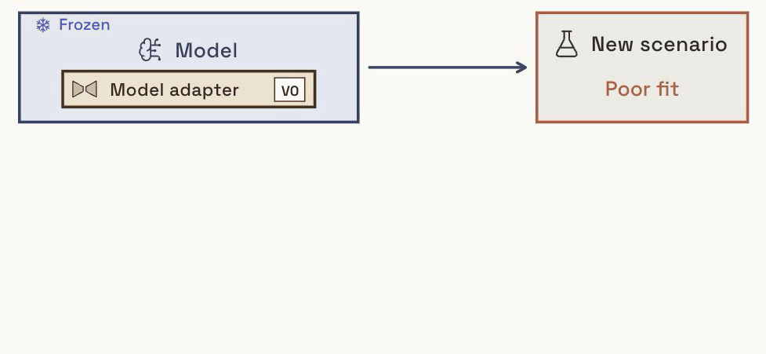
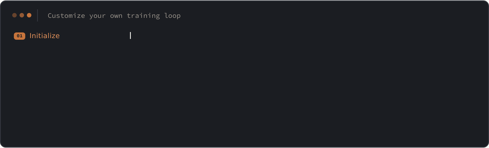
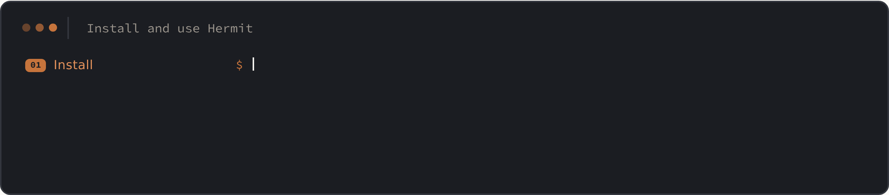

<div align="center">

<picture>
  <source media="(prefers-color-scheme: dark)" srcset="assets/wordmark-dark.svg">
  
</picture>

### A Framework for Continual Learning and RSI through Harness Adapter Evolution

[](LICENSE)
[](pyproject.toml)
[](pyproject.toml)
[](https://infini-ai-lab.github.io/hermit/)
[](https://infini-ai-lab.github.io/hermit/docs/)
[](assets/community/wechat.md)

**[Get Started](#get-started)** · **[Harness Adapters](#what-is-a-harness-adapter)** · **[Methods](#supported-harness-evolution-methods)** · **[Examples and Recipes](#examples-and-recipes)** · **[FAQ](#faq)** · **[Docs](https://infini-ai-lab.github.io/hermit/docs/)**

</div>

---

Hermit is a framework for training, evaluating, and deploying harness adapters, with support for multiple harness evolution algorithms. It adapts your agent to new tasks by evolving an external adapter while keeping your existing model and harness unchanged.

## What Is a Harness Adapter?

A **harness adapter** is a **trainable external harness** (like a plugin with built-in training support). Just as a **model adapter** adapts a model, a harness adapter adapts an existing agent to new scenarios **without modifying its original harness or model.**

<p align="center">

</p>

**Why Harness Adapters?**

Many harnesses are black boxes; even open-source ones have carefully designed component interactions that direct evolution can disrupt. Harness adapters offer three practical benefits: **(1) No changes to your existing harness:** evolve an external adapter through supported extension interfaces, even when both the model and harness are black boxes; **(2) Transferable:** reuse across compatible models and harnesses; **(3) Trainable:** learn from task feedback.

## A Unified Framework for Harness Evolution

### Supported Harness Evolution Methods

<table align="center">
<thead>
<tr>
<th>Status</th>
<th>Methods</th>
</tr>
</thead>
<tbody>
<tr>
<td>✅ <strong>Supported</strong></td>
<td><a href="https://infini-ai-lab.github.io/hermit/docs/methods/gepa.html">GEPA</a> · <a href="https://infini-ai-lab.github.io/hermit/docs/methods/skillopt.html">SkillOpt</a> · <a href="https://infini-ai-lab.github.io/hermit/docs/methods/mwm.html">MetaWorld Model</a> · <a href="https://infini-ai-lab.github.io/hermit/docs/methods/harness2.html">Harness²</a> · <a href="https://infini-ai-lab.github.io/hermit/docs/methods/continual_harness.html">Continual Harness</a></td>
</tr>
<tr>
<td>🚧 <strong>Coming Soon</strong></td>
<td><a href="https://github.com/ace-agent/ace">ACE</a> · <a href="https://arxiv.org/abs/2610.12668">ReHarness</a></td>
</tr>
</tbody>
</table>

Hermit provides an RL-style training loop for evolving harness adapters:

<p align="center">
<picture>
<source media="(prefers-color-scheme: dark)" srcset="assets/training-loop-dark.svg">

</picture>
</p>

### Easy to Use

#### Customize Your Training Loop:

<p align="center">

</p>

#### Run from the Command Line:

<p align="center">

</p>

## Get Started

### Install

Requires Python 3.12+ and Git.

#### From Source (Recommended)

Clone the repository to run the examples, reproduce recipes, or develop your own methods.

```bash
git clone https://github.com/Infini-AI-Lab/hermit.git
cd hermit
python3 -m venv .venv
source .venv/bin/activate
python -m pip install -e .
```

#### From PyPI

To use the framework CLI and bundled adapter templates in your Python environment:

```bash
python -m pip install hermit-harness
hermit --help
```

The Quick Start below uses files from the source checkout. See [Installation](https://infini-ai-lab.github.io/hermit/docs/get-started/installation.html) for method-specific dependencies.

### Method Dependencies

From the checkout root, install only the methods you need. Dependency groups require **pip 25.1+**:

```bash
python -m pip install --upgrade "pip>=25.1"
python -m pip install -e . --group gepa
# Or install every supported method dependency:
python -m pip install -e . --group all
```

Groups `gepa`, `skillopt`, and `harness2` pin their upstream packages to tested Git commits in
`pyproject.toml`. Repeat `--group` to combine methods. Groups are source-checkout configuration;
`pip install hermit-harness` installs the core only. See [Installation](https://infini-ai-lab.github.io/hermit/docs/get-started/installation.html).

### Quick Start

The included **local training walkthrough** connects feedback, an adapter update, evaluation, and deployment. A scripted learner reads the judge's feedback and writes the learned rule.

No model account, GPU, or dataset download required.

#### Train and Evaluate

```bash
hermit check --config docs/_examples/first_training/run.yaml
hermit eval --config docs/_examples/first_training/run.yaml --adapter none
hermit train --config docs/_examples/first_training/run.yaml
hermit eval --config docs/_examples/first_training/run.yaml --adapter final
```

The teaching agent starts by echoing lowercase text. After a failed attempt, the learner writes `Output format: uppercase.` into `ADAPTER.md`. Later executions load the updated adapter.

**Expected in this demo:** baseline `0.0` → final `1.0`, with zero execution errors.

This deterministic example verifies the training contract. Its constructed score gain is not a real-model performance result. The example uses trusted local Python with the learner-program sandbox disabled.

#### Inspect and Deploy

```bash
cat .demo/first-training/first-training/checkout/ADAPTER.md
hermit deploy \
  --adapter .demo/first-training/first-training/checkout \
  --workspace .demo/first-training/workspace \
  --host codex
cat .demo/first-training/workspace/AGENTS.md
```

The generated `AGENTS.md` contains the learned rule. Start Codex in that workspace to use it.

[Full walkthrough, expected outputs, and repeat-run instructions →](https://infini-ai-lab.github.io/hermit/docs/get-started/quickstart.html)

**Ready for a real agent?** [Train with an API model](https://infini-ai-lab.github.io/hermit/docs/get-started/first-model.html) · [Run OfficeQA](https://infini-ai-lab.github.io/hermit/docs/recipes/officeqa.html) · [Bring your own task](https://infini-ai-lab.github.io/hermit/docs/tutorials/your-own-task.html)

### Examples and Recipes

#### Harness Evolution Recipes

Train and evaluate harness adapters on benchmarks using different evolution methods. Each task's README reports results; each included adapter's `.hermit/CARD.md` records evaluation details.

<table align="center">
<thead>
<tr>
<th>Method</th>
<th>Recipes</th>
</tr>
</thead>
<tbody>
<tr>
<td><a href="https://infini-ai-lab.github.io/hermit/docs/methods/mwm.html">MWM</a></td>
<td><a href="examples/clbench_database/mwm/">CL-Bench database</a> · <a href="examples/clbench_poker/mwm/">CL-Bench poker</a> · <a href="examples/servelearnbench/mwm/">ServeLearnBench</a></td>
</tr>
<tr>
<td><a href="https://infini-ai-lab.github.io/hermit/docs/methods/skillopt.html">SkillOpt</a></td>
<td><a href="examples/officeqa/skillopt/">OfficeQA</a></td>
</tr>
<tr>
<td><a href="https://infini-ai-lab.github.io/hermit/docs/methods/gepa.html">GEPA</a></td>
<td><a href="examples/officeqa/gepa/">OfficeQA</a></td>
</tr>
<tr>
<td><a href="https://infini-ai-lab.github.io/hermit/docs/methods/harness2.html">Harness²</a></td>
<td><a href="examples/officeqa/harness2_stream/">OfficeQA</a> (the paper's per-question protocol, Codex as the acting agent)</td>
</tr>
<tr>
<td><a href="https://infini-ai-lab.github.io/hermit/docs/methods/continual_harness.html">Continual Harness</a></td>
<td><a href="examples/officeqa/continual_harness/">OfficeQA</a> (policy, sub-agents, skills and memory refined in place, Codex as the acting agent)</td>
</tr>
<tr>
<td><a href="https://infini-ai-lab.github.io/hermit/docs/methods/prompt-only.html">Prompt-only</a></td>
<td><a href="examples/clbench_database/prompt_only/">CL-Bench database</a> · <a href="examples/clbench_poker/prompt_only/">CL-Bench poker</a> · <a href="examples/servelearnbench/prompt_only/">ServeLearnBench</a></td>
</tr>
</tbody>
</table>

Walkthroughs: [OfficeQA](https://infini-ai-lab.github.io/hermit/docs/recipes/officeqa.html) · [CL-Bench](https://infini-ai-lab.github.io/hermit/docs/recipes/clbench.html) · [ServeLearnBench](https://infini-ai-lab.github.io/hermit/docs/recipes/servelearnbench.html).

Smaller training demos: [Quick Start](https://infini-ai-lab.github.io/hermit/docs/get-started/quickstart.html) (offline) · [First real-model training](https://infini-ai-lab.github.io/hermit/docs/get-started/first-model.html). [Task folder layout](examples/README.md).

#### Harness Adapter Examples

The finished [Lean collaboration adapter](examples/lean_swarm/) coordinates five Codex agents through shared tools, state, and skills to prove Lean theorems together. [Walkthrough →](https://infini-ai-lab.github.io/hermit/docs/recipes/lean-collaboration.html)

#### More Starting Points

<table align="center">
<thead>
<tr>
<th><a href="https://infini-ai-lab.github.io/hermit/docs/tutorials/deploy-an-adapter.html">Use a trained adapter</a></th>
<th><a href="https://infini-ai-lab.github.io/hermit/docs/get-started/first-model.html">Train for your tasks</a></th>
<th><a href="https://infini-ai-lab.github.io/hermit/docs/framework/custom-evolver.html">Build a new method</a></th>
</tr>
</thead>
<tbody>
<tr>
<td>Deploy to your agent.</td>
<td>Use your tasks and feedback.</td>
<td>Implement and compare your idea.</td>
</tr>
</tbody>
</table>

#### What You Need for Each Starting Point

<table align="center">
<thead>
<tr>
<th>Your goal</th>
<th>What Hermit provides</th>
<th>What you bring</th>
</tr>
</thead>
<tbody>
<tr>
<td><strong>Use an existing adapter</strong><br><a href="https://infini-ai-lab.github.io/hermit/docs/tutorials/deploy-an-adapter.html">Use an adapter →</a></td>
<td>Workspace deployment and native plugin conversion for a compatible adapter.</td>
<td>An adapter, a supported agent host, and any dependencies the adapter needs.</td>
</tr>
<tr>
<td><strong>Adapt to your own tasks</strong><br><a href="https://infini-ai-lab.github.io/hermit/docs/get-started/first-model.html">Train your adapter →</a></td>
<td>Existing templates and Evolvers, with a Trainer that connects execution, feedback, checks, and versioning.</td>
<td>Your tasks, acting agent, evaluator, and model access.</td>
</tr>
<tr>
<td><strong>Develop a learning method or adapter design</strong><br><a href="https://infini-ai-lab.github.io/hermit/docs/framework/custom-evolver.html">Build a learning method →</a></td>
<td>Editable adapter specifications and an Evolver interface for implementing and comparing methods on shared task pipelines.</td>
<td>Your adapter design or update algorithm, plus an evaluation task.</td>
</tr>
</tbody>
</table>

#### Deploy an Adapter Without Training

```bash
mkdir -p .demo
cp -R hermit/algorithms/templates/prompt_only .demo/adapter
hermit deploy --adapter .demo/adapter --workspace .demo/codex-workspace --host codex
cat .demo/codex-workspace/AGENTS.md
```

#### Train on OfficeQA

Prepare the dataset and model endpoint as described in the [OfficeQA recipe](https://infini-ai-lab.github.io/hermit/docs/recipes/officeqa.html). The agent uses SkillOpt's rollout, so install the `skillopt` and `gepa` dependency groups (pip 25.1+). Sandboxed agent Evolvers require Linux with `bubblewrap`.

```bash
python -m pip install -e . --group skillopt --group gepa
python examples/officeqa/utils/prepare.py --csv /path/to/officeqa_full.csv --docs /path/to/treasury_bulletins_parsed
hermit check --config examples/officeqa/gepa/smoke.yaml
hermit train --config examples/officeqa/gepa/smoke.yaml
hermit eval --config examples/officeqa/gepa/smoke.yaml --adapter final
```

#### Use Your Own Model Server

Models use `<backend>/<model id>` references. See [Model backends](https://infini-ai-lab.github.io/hermit/docs/guides/model-backends.html) for endpoint configuration and requirements.

```bash
vllm serve Qwen/Qwen3-30B-A3B-Instruct-2507-FP8 --enable-auto-tool-choice --tool-call-parser hermes
hermit backends check vllm/Qwen/Qwen3-30B-A3B-Instruct-2507-FP8
hermit train --config examples/officeqa/gepa/smoke.yaml model=vllm/Qwen/Qwen3-30B-A3B-Instruct-2507-FP8 llm=vllm/Qwen/Qwen3-30B-A3B-Instruct-2507-FP8
```

#### Convert a Trained Adapter into a Plugin

```bash
hermit convert --adapter DIR --output OUT --target codex
# Other targets: claude-code, pi, hermes
```

## FAQ

<details>
<summary><strong>How Is a Harness Adapter Different from a Plugin?</strong></summary>

Think of it as a plugin with built-in training support: it defines what can be learned and checked, while Hermit manages updates and versioning from task feedback. A compatible adapter can be deployed as a native plugin.

</details>

<details>
<summary><strong>What Can a Harness Adapter Contain?</strong></summary>

A harness adapter can contain instructions, skills, memory, tools, executable code, and agent coordination logic. It can be an entire repository implementing an external harness.

Its specification defines how the agent uses it, which parts can be trained, and how updates are checked—while keeping the original model and harness unchanged.

</details>

<details>
<summary><strong>Why Not Evolve the Original Harness Directly?</strong></summary>

Many harnesses are closed-source, and changing a carefully designed harness can disrupt its component interactions. An adapter keeps learned changes in an external layer while leaving the original harness and model fixed.

</details>

<details>
<summary><strong>When Should I Use Hermit?</strong></summary>

Use Hermit to deploy an existing adapter, train one on your tasks, or develop and compare harness evolution methods through a shared training interface.

</details>

[Full FAQ: training, transfer, supported methods, and evaluation →](https://infini-ai-lab.github.io/hermit/docs/faq.html)

## Community

Join our [WeChat community](assets/community/wechat.md) to discuss harness evolution, share experiments, and connect with other users and contributors.

## Contributing

Help extend Hermit by [implementing an Evolver](https://infini-ai-lab.github.io/hermit/docs/framework/custom-evolver.html), [connecting a task](https://infini-ai-lab.github.io/hermit/docs/tutorials/your-own-task.html), or [reporting a reproduction or integration issue](https://github.com/Infini-AI-Lab/hermit/issues).


## License

[Apache-2.0](LICENSE)
