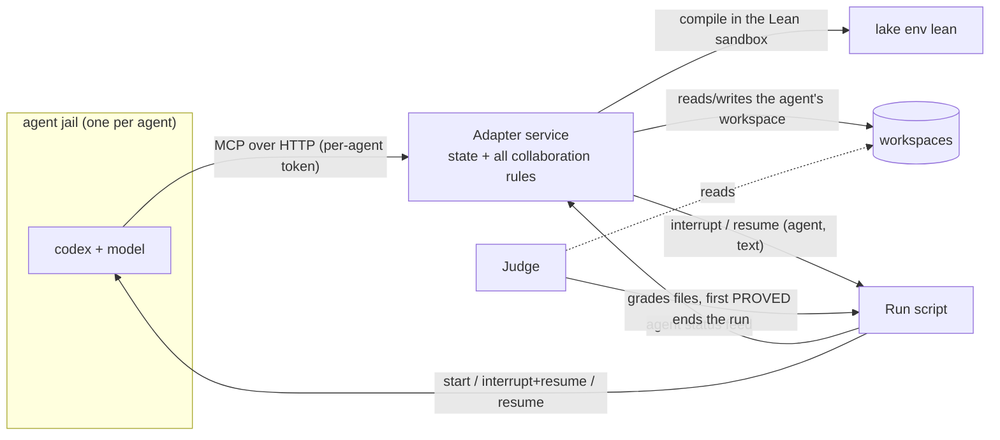

# Async-collab adapter as a standalone service — design

Date: 2026-09-30. Status: draft for review; nothing implemented.
Scope: the Lean collaboration experiment (`~/code/lean-results/fc_collab_auto`, adapter `adapters/v29`, launcher `~/code/lean-results/fc_multi/ma_run.py`).
Predecessor: [async-collab-adapter-design-2026-09-27.md](async-collab-adapter-design-2026-09-27.md).

## 1. Decision

The adapter is a standalone service whose lifecycle is independent of the agents (user, 2026-09-30).
It starts before the agents, keeps running while agents connect, disconnect, are interrupted or resumed, and holds the
team state and every collaboration rule. Agents reach it through MCP exactly as today: same tools, same arguments, same
replies, same notice texts. Only the code structure and the MCP transport change.

Acceptance criterion: **no behaviour change.** Replaying recorded rounds through the service must reproduce the tool
replies and the notices that were actually produced (section 8).

## 2. Today

| Piece | Where | Lifecycle | Holds |
|---|---|---|---|
| Adapter | `adapters/vNN/collab.py`, loaded by `harnessadapter.runtime.mcp_server` over stdio | one process per agent, started by that agent's codex inside its jail; dies with the session | nothing in memory; shares `library/state.json` with the four other processes through `state.lock` |
| Launcher | `fc_multi/ma_run.py`, one per problem | whole run | agent processes, grading, and a second half of the collaboration rules (section 5) |

Consequences:

1. The adapter acts only when an agent calls a tool. Everything proactive — delivering a map, telling a holder its part
   was proved, pushing a silent agent — has to be written by the adapter into `interrupts.jsonl` and carried out by the
   launcher, or decided by the launcher itself.
2. The rules are split across two files. `ma_run.py` is shared by all adapter versions, so a launcher change alters
   every version at once. On 2026-09-30 it changed twice (16:44 stale-threshold fix, 18:00 `defer`), so r33 (v28) and
   r34 (v29) do not run under the same rules outside the adapter.
3. The launcher also runs `run_check` for an agent whose `Problem.lean` changed (at most every 30 s); this is adapter
   logic executed from a different process.

## 3. Target architecture

Three components, each with its own lifecycle:

| Component | Owns | Knows nothing about |
|---|---|---|
| **Adapter service** | team state; tools; every rule that decides what an agent is told and when; persistence and snapshots | how agents are started, which host (codex, Claude) runs them |
| **Run script** (the simplest possible run; there is no launcher any more — user, 2026-09-30) | starting the service, the judge and the agents; executing the adapter's commands (interrupt+resume with a text, resume an ended session with a text); the per-agent status feed | why or when to interrupt or resume; any collaboration rule |
| **Judge** | grading, winner, time to solve, the 7200-s cap, stopping the run, `result.json`, workspace size limit | collaboration |

The run script and the judge are frozen infrastructure, versioned separately; an adapter version is then the complete
description of the collaboration mechanism.

## 4. Interfaces

### 4.1 Agent ↔ adapter (unchanged)

MCP tools `check`, `pull`, `refute`, `say`, `plan` with today's schemas (`adapters/v29/adapter.json`). The service
identifies the caller by a per-agent bearer token (`codex mcp add --url … --bearer-token-env-var …`; codex 0.155.1
supports streamable-HTTP MCP servers, checked 2026-09-30). The token replaces the `COLLAB_AGENT` environment variable;
`COLLAB_WORKSPACE`, `COLLAB_TARGET` become per-agent service configuration.

### 4.2 Run script → adapter: status feed

The run script reports, for each agent, the facts the rules need today (all currently computed inside `ma_run.py`):

| Field | Today's source |
|---|---|
| `running` / `exited` / `stopped`, `t_start`, time left before the cap | `agents[me]['status']`, `t_start`, `CAP` |
| `busy`: a command or MCP call is pending | `agent_busy()` (last 2 MB of `events.jsonl`, pending older than 10 min ignored) |
| `last_tool_call` | mtime of `tool-calls.jsonl` (the service sees tool calls itself; kept for parity) |
| `problem_mtime` | mtime of `Problem.lean` |
| `t_interrupted` | last interruption time |

Pushed on change or polled every 5 s (today's `POLL`).

### 4.3 Adapter → run script: commands

Two commands, both carried out at once by the run script, which reports `done` or `not running`:

- `interrupt(agent, text)`: stop the agent's session and resume it with `text`;
- `resume(agent, text)`: resume a session that has ended.

Every decision belongs to the adapter (section 5): staleness, spacing, waiting for a quiet moment or for a running
command, and whether an ended session is resumed at all (today: unproved, more than 2 min left, at most 3 times —
user, 2026-09-30: the adapter decides this too). The run script decides nothing.

### 4.4 Judge → run script

`stop_all(reason)` when a file grades PROVED or the cap is reached. The judge reads workspaces directly; it never reads
adapter state.

## 5. Rules moved from `ma_run.py` into the adapter

Every rule below is behaviour of today's system; it moves unchanged (numbers and texts included).

| # | Rule (today in `ma_run.py`) | Parameters |
|---|---|---|
| 1 | Host-side ingest: run `run_check(deliver=False)` for an agent whose `Problem.lean` changed; results the agent should hear become `pending` lines of its next tool reply | at most every 30 s per agent, one at a time |
| 2 | Notice gate, in this order: already handled → skip; before `not_before` → wait; stale → drop; agent not running → drop; `defer` notice within spacing → wait; non-urgent within spacing or last 5 min of the cap → drop; non-urgent and agent called a tool in the last 3 min → wait; agent busy and notice younger than 8 min → wait; else deliver | stale 1500 s urgent / 600 s other; spacing 300 s |
| 3 | Phase-1 push: no map, run ≥ 15 min, agent running with ≥ 10 min left, not interrupted in 15 min, no tool call for 15 min (never-calling agents counted from t0), not pushed in 15 min, not busy → urgent notice `phase1_text` | 900 s, 600 s |
| 4 | Idle rule (phase 2): on no open node, or registered but no tool call for 15 min (then counted as already 10 min idle) → after 10 min, ≥ 10 min since the last interruption, > 5 min left → urgent notice `idle_text` | 600 s, 900 s, 300 s |
| 5 | Snapshots of the state every 30 s (`snapshots/state_tNNNNN.json`), used by the timeline page | 30 s |
| 6 | Served-notice log (`interrupts.done`, `interrupts.log`) so that a resumed run does not repeat a delivery | — |
| 7 | Resume an agent whose session ended: not proved, more than 2 min left before the cap, at most 3 resumes; text = `resume_text` | 120 s, 3 |

The adapter-side notices stay as they are: map delivery (urgent), "your part was proved" (non-urgent), cascade
retirement (non-urgent, `defer`). Rules 1–4 need the status feed (4.2) and a clock: the service runs a 5-s tick.

Stays outside the adapter: grading, winner and solve time (file save time), final grading of every file, cap, stop,
`result.json`, workspace size limit (judge); starting codex and the mechanics of stopping and resuming a session
(run script).

## 6. State, persistence, concurrency

- One process holds the state in memory; tool calls and ticks mutate it under one in-process lock. `state.json` is
  written atomically after every mutation (same file and format as today, so `round_summary.py`, `early_lean.py`,
  `team_contact.py`, `replay.py` and `viz/` keep working).
- Compiles run outside the lock (as today): parse the file, compile, then take the lock to apply the result.
- Restart: the service reloads `state.json` and `interrupts.done`; this replaces today's `MA_RESUME` path for the
  collaboration part.
- One service instance per problem run (five per round), so runs stay independent.

## 7. Isolation

All experiments stay isolated (files, network, environment). Two changes need a preflight that is measured, not
inferred:

1. **MCP route into the jail.** Each agent's codex runs in a bwrap jail with its own network namespace
   (`--unshare-net`); the host's 127.0.0.1 is not visible there. The model API is reached today through a relay socket
   bridged into the jail (`fc_screen/sandbox.py`, `relay=`). The service gets the same treatment: a unix socket bound
   into the jail and bridged to a jail-local port that codex's `--url` points at.
2. **Compiles leave the jail.** Today `check` compiles inside the agent's jail (the stdio server is a child of codex).
   The service compiles on the host, so each compile runs in the Lean sandbox (`fc_screen/sandbox.py`, no network,
   read-only toolchain and Mathlib, only that agent's workspace writable).

Preflight, per agent jail: (a) codex reaches the service and the model; (b) nothing else is reachable; (c) a shell or
Python command the model runs cannot reach the service socket or port (otherwise an agent could bypass the tools and
edit team state); (d) a compile launched by the service cannot read other workspaces or the network.

## 8. Validation (behaviour unchanged)

1. **Tool-level replay.** Feed the recorded tool calls of r32 and r33 (`A*/tool-calls.jsonl`, with times) and the
   recorded `Problem.lean` versions into a fresh service; compare each reply field by field with the recorded reply.
   Compile timing differs, so compare the state transitions (verified lemmas, nodes opened/closed/retired, holders),
   not durations.
2. **Notice-level replay.** Drive the tick with the recorded status (agent starts, exits, busy spans from
   `events.jsonl`, tool-call times); compare the notices the service would deliver, and their times within one tick,
   with `interrupts.log` / `interrupts.done`.
3. `replay.py` invariants (maps, dependency closure, pulls compile) must pass as for any version.
4. Isolation preflight (section 7).
5. One pilot problem, then paired rounds.

## 9. Plan

| Step | Content | Output |
|---|---|---|
| 1 | Service runtime in the framework: MCP over streamable HTTP, per-agent tokens, in-memory state with atomic persistence, 5-s tick, status-feed and delivery endpoints | `harnessadapter/runtime/` |
| 2 | Adapter core v30 = v29 behaviour with rules 1–6 moved in (hooks: `on_tick(status)`, `on_file_changed(agent)` returning deliveries) | `adapters/v30` |
| 3 | Replace `ma_run.py` by a minimal run script (start service, judge, agents; execute `interrupt` / `resume`) and a judge; no collaboration logic outside the adapter | `fc_multi/` |
| 4 | Jail bridge for the service socket; Lean sandbox for service-side compiles; preflight | `fc_screen/sandbox.py` |
| 5 | Replays of section 8 on r32 and r33 | report in `LOG.md` |
| 6 | Pilot, then paired rounds of v28-rules and v29-rules under the new run script (the old pair ran under different launcher code) | rounds |

## 10. Open questions

1. Delivery without killing the session: codex `exec` offers no way found so far to inject a message into a running
   turn, so delivery stays interrupt+resume. Not verified beyond the CLI help.
2. Whether rule 1 (host-side ingest) should stay: with a standalone service it is the only way the team learns of work
   an agent has not checked. Kept for parity; a candidate for a later hypothesis, not for the migration.
3. ~~Whether reactions belong in the general contract.~~ Decided 2026-09-30 (user: the contract may change): adopted as a
   fourth export, **Reactions**, in [adapter-contract-v0.md](adapter-contract-v0.md) section 7.
