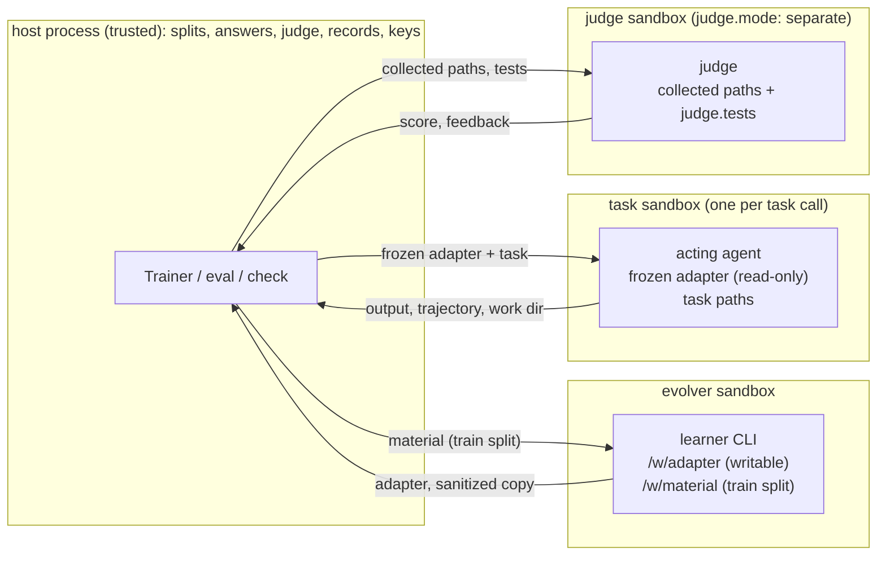
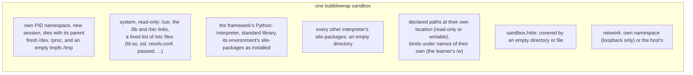
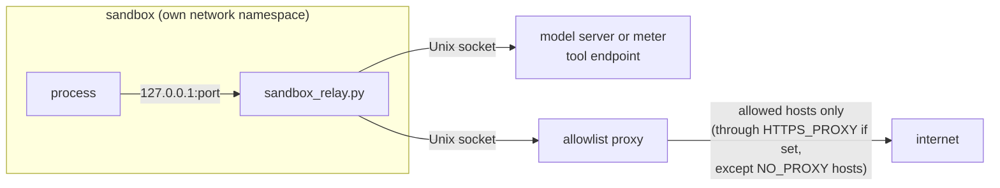

# How the sandbox works

Every process hermit starts while it trains, evaluates or checks runs in a bubblewrap sandbox: the acting agent, the
judge (unless it runs on the host), the learner, the adapter's own code and the declared tools. This page shows how
those sandboxes are built, what is inside each one, and what they do not protect against. The settings are in
[Configuration](../framework/configuration.md#sandboxes); the design and its decisions are in
[Sandbox design](../developer/sandbox-design.md).

The host process (the Trainer, `hermit eval`, `hermit check`) is the only trusted part. It holds the data and split
files, the answers, the judge, the run records and the model credentials, and every handoff between sandboxes goes
through it.

## Roles and sandboxes

Three roles run in three kinds of sandbox. Sandboxes never reach each other; the host copies what passes between
them.



| Sandbox | Who runs inside | What is inside | Never inside |
|---|---|---|---|
| task | the acting agent, one worker per call; a task's declared tools; a `shared` judge after the agent | the declared task paths, packages and variables; the framework's Python environment; the acting layer; the frozen adapter; its model's key | the data and split files, the judge and its tests, the runs and trees |
| judge | the judge in `shared` mode (a new exec in the task sandbox) or `separate` mode (a fresh sandbox) | the judge's file and `judge.tests`; `separate`: only the paths `judge.collect` names, copied through a sanitized archive | in `separate` mode, everything else the agent left |
| evolver | the learner's sessions, its roles, the programs it runs | the workspace under `/w`, the learner CLI, what the method declares, its models' keys | the framework's code (unless the method runs it), the data, the judge, the test split |

With `judge.mode: host` (the default) the judge runs in the host process on the downloaded output. Three cases run the
acting pipeline in the host process instead of a task sandbox, and each is recorded: `sandbox.enabled: false`, a
Harbor task set (Harbor's container is its environment), and `environment.runner: host` (a task whose own code
isolates what it runs, such as AgentDyn's hooks). With `environment.image`, a Codex acting agent runs in a Docker
container of its own, started by a worker on the host.

## How one sandbox is built

`hermit/sandbox.py` builds every sandbox as a bubblewrap command line. It is an allowlist: a path, a variable or a
host that is not declared does not exist inside.



The pieces, in the order they are applied:

1. **Process.** `--die-with-parent --new-session --unshare-pid`: the sandbox sees only its own processes, cannot reach
   the host's through `/proc`, and ends when the process that started it ends. `/tmp` is an empty tmpfs each time.
2. **System.** `/usr` read-only, the `/lib`, `/lib64`, `/bin`, `/sbin` links as on the host, and only these `/etc`
   files: `ld.so.cache`, `ld.so.conf(.d)`, `alternatives`, `ssl`, `pki`, `resolv.conf`, `hosts`, `nsswitch.conf`,
   `passwd`, `group`, `localtime`, `crypto-policies`, `os-release`. The user's home is not shown.
3. **Python.** The interpreter hermit runs on, its standard library, and its environment's site directories as
   installed: whatever is installed there can be imported (`pip install 'hermit-harness[sandbox]'` installs numpy,
   pandas, scipy and torch). Not shown:
   - what a `.pth` file adds beside them, such as an editable install's checkout. `environment.packages` names such a
     distribution to show its package and its dependencies;
   - every other interpreter's site directory (a venv's base installation, a system Python under `/usr`): it is
     replaced by an empty directory;
   - the hermit package itself, unless the sandbox runs framework code (`framework`, as CommandEvolver's does).

   The interpreter's other names beside it (`python3` beside `python`) are shown, and when another interpreter comes
   first on `PATH` (hermit started from a virtual environment that is not activated), the interpreter's directory is
   moved to the front inside. A `python3` that a shell or a `#!/usr/bin/env python3` line looks up inside then runs
   on hermit's environment (unless that directory's `python3` is another version, as on the host). The sandbox's own
   command is found on the host's `PATH` before it starts: give a Python command as an absolute path
   (`sys.executable`).
4. **Programs.** A command started by name is run by its real path. Its installation is shown (a CLI under
   `~/.local/bin` and the package it belongs to, the interpreter its `#!` line names), with that installation's
   Python packages emptied, unless the program itself runs on Python (a pipx or venv install keeps its own).
5. **Declared paths.** Task paths, the call's work directory, the learner's workspace (bound under `/w`), and the
   collected paths of a `separate` judge. Paths under a bound source are translated in the command, the environment
   and the working directory, so the process sees the names it was told.
6. **`sandbox.hide`.** Each named module or package is covered under every name it is reachable by: a directory by an
   empty one, a file by an empty file, its package's `__pycache__` by an empty directory. Every sandbox except the
   judge's. The run passes the list to the processes it starts in `HA_SANDBOX_HIDE`, so a sandbox a worker starts
   covers it too.
7. **Variables.** Only the declared ones (names or patterns such as `MWM_*`), the model key variables of the models
   this sandbox calls, and a fixed set the framework needs: `PATH`, `HOME`, `LANG`, `LC_ALL`, `TERM`, `PYTHONPATH`,
   `CODEX_HOME`, `CLAUDE_CONFIG_DIR`, `HA_CONTEXT`, `HA_TOOL_URL`, `HA_SANDBOX_HIDE`.
8. **Limits.** `memory_mb`, `file_mb` and `cpu_s` become `RLIMIT_AS`, `RLIMIT_FSIZE` and `RLIMIT_CPU`, set on the
   command by the relay.

## Network



- `no-network` and `allowlist` give the sandbox its own network namespace with loopback only. The ports it needs (its
  model server or meter, the tool endpoint, the loopback URLs in its environment, the allowlist proxy) are forwarded
  over Unix sockets by `hermit/sandbox_relay.py`. A URL in the command's arguments is never forwarded: a prompt can
  carry the learner's text.
- The allowlist proxy forwards CONNECT and plain HTTP only to the allowed hosts: the model providers of this sandbox's
  models and the declared `allowed_hosts`. On a machine whose only way out is an egress proxy (`HTTPS_PROXY`,
  `http://` or `https://`), it goes out through that proxy, except to the hosts `NO_PROXY` names.
- `public` is the host's network, unfiltered.

## The check before every start

Before the command starts, the relay checks from inside that an outside connection fails (with an isolated network),
that every forwarded port answers, and that the run's secrets and the home's `.ssh` and `.bashrc` are absent. If the
check fails, the command does not start. Each start of a task, judge, tool or learner sandbox in a run writes a
record, `sandbox/<role>-<n>.json` in the run directory: what was bound and under which names, the forwarded ports,
the variables passed, and the check (`hermit eval` writes its own beside its results). `hermit check`'s probes and
the strict spec and render sandboxes keep none.

## Models and keys

A sandbox gets the keys of the models it calls, the way Harbor gives its agents theirs: the key variable passes in, the
provider's host is allowed, and a model server or meter on the loopback is forwarded. A Codex ChatGPT login is copied
in and its hosts are allowed.

What the run keeps is scrubbed of every key value (`hermit/redact.py`): each value of a key-like variable of the
Trainer (`..._API_KEY`, `..._KEY`, `..._TOKEN`, `..._SECRET`, at least 16 characters) becomes `<VARIABLE>`, in file
contents and in file names. [Sandbox design](../developer/sandbox-design.md#models-and-keys) lists everything that is
scrubbed and when.

## The evolver's workspace

The learner's working directory is `/w`:

```text
/w/adapter      the working copy (writable)          /w/state       state across calls (writable)
/w/material     the learning material                /w/scratch     scratch (writable)
/w/task-info    the task description                 /w/output      output (writable)
/w/history      the adapter's history                /w/root        the template's root
/w/method       the Evolver's directory              /w/validation, /w/environment/<name>  evolver_access
/w/agent-logs   run_agent's copies of the logs
```

A method can declare a view of its own instead. MWM shows its native names (`/w` as the adapter, `/evidence`,
`/environment`, `/skills`, `/patterns`, `/world-model`). RRSI gives each proposer and role its own directory, and
harness2 gives each session its own. The adapter leaves the sandbox as a copy made inside it and then sanitized:
links that point outside, special files and setuid bits are dropped.

## Running a command in a sandbox yourself

A launcher that hands another program a command prefix can run a command in a sandbox made from a JSON spec of
`Sandbox` fields:

```bash
python -m hermit.sandbox '{"readable": ["/data/corpus", "/home/me/jobs"], "writable": ["/home/me/out"],
  "network": "isolated", "env_allow": [], "chdir": "/home/me/jobs"}' -- "$(which python)" job.py
```

`env_allow` lists the variables that pass besides the few every sandbox needs (`PATH`, `HOME`, ...); left out,
every variable of the calling process passes.

The run's `sandbox.hide` (from `HA_SANDBOX_HIDE`) applies here too. The Lean swarm's agent jails and compiles use it
(`examples/lean_swarm/launch.py`).

## Warnings

:::{warning}
**Agents and learners can read their model keys.** A sandbox holds the keys of the models it calls, as Harbor's
agents do. The run's own outputs are scrubbed, but what a sandbox sends to its allowed hosts is not inspected, and
neither is what a process writes outside its declared paths.
:::

:::{warning}
**What a sandbox can import depends on the machine.** Packages come from the environment hermit runs in, so two
machines with different packages give different sandboxes; each start's record lists what was bound. Install the
`sandbox` extra for a common base. An editable checkout is not shown unless `environment.packages` names it.
:::

:::{warning}
**Scoring code inside the agent's own package is visible.** `sandbox.hide` can cover a scoring module only if the
agent does not import it. When a benchmark's environment and scoring share one package, the agent sees the scoring:
ServeLearnBench (`servelearnbench`), AgentDyn (its judge predicates live beside its tasks), CL-Bench (its runner
grades each question beside the host it plays), and OfficeQA (SkillOpt's rollout imports its evaluator).
:::

:::{warning}
**Some settings remove the boundary.** `sandbox.enabled: false` confines nothing and holds nothing back.
`sandbox.enforce: best_effort` runs unconfined when bubblewrap is missing and only records it. `network: public` is
the host's network. `environment.runner: host` runs the pipeline in the Trainer's process. None of these is for
reported results.
:::

:::{warning}
**Linux only.** The sandboxes need bubblewrap, so there is no evolver sandbox on macOS. Web search runs at the model
provider, outside any sandbox; only the CLI's `web_search` setting turns it off.
:::

:::{warning}
**Containers cover less of this page.** With `environment.image` only a Codex acting agent is supported, and the
container holds its image's own packages: `sandbox.hide` does not reach them. The `shared` and `separate` judge modes
need the bubblewrap task sandbox. With an image, a Harbor task set or `runner: host`, the judge runs on the host.
:::

:::{warning}
**Nothing persists in `/tmp`.** Each sandbox gets an empty `/tmp`. Write what must outlive the call to the work
directory or a declared writable path.
:::
