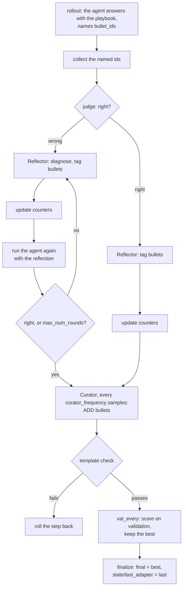

# ACE

ACE, Agentic Context Engineering ([Zhang et al., ICLR 2026](https://arxiv.org/abs/2510.04618),
[code](https://github.com/ace-agent/ace)), treats the context as a playbook that grows by incremental deltas
instead of being rewritten: bullets `[id] helpful=N harmful=N :: content` under sections, tagged by a Reflector and
extended by a Curator. Choose it when the adapter is a context document, you have the judge's feedback on training
tasks, and you want the accumulated detail kept rather than compressed (the paper's "brevity bias" and "context
collapse"). The answers come from the task's own acting agent, which reads the playbook as part of its instructions,
where the authors' code makes a separate LLM call; as in the paper, only the playbook is learned.

## Setup

```yaml
template: ace@1.0
evolver:
  name: ace
  params: {feedback: true, max_num_rounds: 3, val_every: epoch}
data:
  step_size: 1          # ACE's per-sample loop
  val: splits/val.txt   # optional: keeps the best validation playbook
llm: {model: <backend>/<model>}   # the Reflector's and the Curator's model
```

With `learner: codex` the Reflector, the Curator and the merges are `codex exec` sessions under the user's own
Codex login (a ChatGPT account, `codex login`) instead of the `llm` tool: read-only, the prompt on stdin, the reply
Codex's last message. A Codex session runs commands, and read-only limits its writes, not its reads, so every session
gets two new directories, removed after it: an empty working directory and a Codex home holding only a copy of the
login. It sees no other file of the machine and no earlier session. With `learner_container: {image, network,
proxy}` each session is a container of that image with only those two directories mounted, reaching the provider
through the proxy; otherwise the run's sandbox confines it with bubblewrap, and a sandbox that cannot (`enforce:
best_effort` without bubblewrap, as on macOS) makes the step fail rather than run it unconfined. The run keeps one
copy of the login (removed at finalize), and a token a session refreshed is written back to it. A session the
provider could not serve runs again, `learner_unavailable_attempts` times in all, `learner_unavailable_wait_s`
apart; a session that fails or writes no reply fails the step. `temperature` and `max_tokens` do not apply, and a
subscription's cost is recorded as unknown.

The template's `ADAPTER.md` is the acting agent's context: any text the adapter started with (for example a task
skill), then the generator instructions and the playbook between markers. Starting from an adapter without a
playbook, the Evolver's bootstrap appends the empty one. The de-duplication option needs
`python -m pip install -e . --group ace` (sentence-transformers).

## One framework step

The acting agent is ACE's Generator: the Trainer's rollouts are its attempts with the playbook as context, and it is
asked to name the bullet ids it used on a `bullet_ids:` line of its final message. Then, for each rollout in turn
(`ACE._train_single_sample`):

1. the ids the agent named are collected (the Generator's regular-expression fallback; a copy of a playbook line,
   id followed by its counters, is not a citation);
2. a wrong answer: up to `max_num_rounds` rounds of reflect, update the counters, run the agent again on the task
   with the reflection after its context (`run_agent`), stopping when it is right; a right answer: one reflection,
   to tag the bullets. The Reflector tags the named bullets helpful, harmful or neutral; the counters are updated
   without a model;
3. every `curator_frequency` samples, the Curator turns the last reflection into ADD operations, merged into the
   playbook deterministically (new ids, a section that does not exist goes to OTHERS);
4. with `use_bulletpoint_analyzer`, bullets whose embeddings are at least `bulletpoint_analyzer_threshold` similar are
   merged by a model call.



The updated playbook must pass the template check, or the step is rolled back. With `val_every`, the playbook is
scored on validation and the best is kept; `finalize` hands it back. No validation: the current playbook is final.
Either way finalize also saves the playbook as training left it, as a complete adapter in `state/last_adapter`, so
it can be evaluated beside `final` when the validation split is too small to select on.
`state/ace.json` records every sample (named bullets, tags, retry scores, the Curator's outcome, bullets added) and
the playbook's size per step; `output/calls/` holds every prompt and reply.

## Parameters

```{literalinclude} ../../hermit/algorithms/evolvers/ace/evolver.yaml
:language: yaml
```

## The authors' implementation against this one

The authors' code is not called: it cannot be imported as a library (no build configuration; top-level modules named
`utils`, `llm` and `logger` that pull in its API clients), so `evolver.py` and `playbook.py` port it function by
function, each naming the upstream function it follows, with the prompts verbatim (the Generator's adapted).
`prompt-only` was not used: it has no place for the playbook's sections and counters or a check that keeps them
parseable. Every difference below is acceptable for the offline setting measured here; online ACE, not ported, is
the one left open.

| Dimension | ace-agent/ace (82709de) | This Evolver | Why |
|---|---|---|---|
| When learning happens | Per sample: generate, reflect (with retries), curate | Per step, over the step's rollouts one by one; `step_size: 1` is the same loop | Framework (a step is a batch of rollouts) |
| The Generator | An LLM call returning JSON `{reasoning, bullet_ids, final_answer}` | The acting agent with the playbook as context; the agent writes one `bullet_ids:` line in its final message and the ids are collected with upstream's regex fallback; instructions adapted from `GENERATOR_PROMPT` (asking for ids in its reasoning failed: a Codex session's reasoning is not recorded, so `cited` stayed empty) | Framework and task: the agent's prompt and answer format are fixed |
| What the Reflector sees | Question, the Generator's reasoning, prediction, ground truth (GT mode), "matches / does not match ground truth", the bullets used | Task input, the agent's trajectory (middle cut past `trace_chars`), prediction, the same verdict string plus the judge's feedback, the bullets named. Always `REFLECTOR_PROMPT_NO_GT` | Framework: no reference-answer channel; on OfficeQA the judge's feedback names the expected answer, so `feedback: true` is supervised as GT mode is |
| Retry rounds | Regenerate with the reflection in the prompt | `run_agent` with the reflection after the context; its trajectory read from the run's log | Framework |
| Label-free | `--no_ground_truth` hides the answer text but still decides correctness from labels and gates the retries | `feedback: false`: the run's own status only, no verdict, no retries, `*_NO_GT` prompts | Decision: label-free in the strict sense |
| The update | ADD only; counters; content written as given | Same; a newline inside content becomes a space so a bullet stays one line | Decision |
| De-duplication | Off by default; faiss-normalised embeddings, threshold 0.90, LLM merge (temperature 0.3) keeping what the model wrote | Same grouping and prompt; the merged line keeps the first id and the summed counts | Decision: an id can never repeat |
| Selection | Validation every `eval_steps` samples (default 100, which never fires on 50 training questions); best starts as the initial playbook at 0 | `val_every: epoch` by default (or every N samples); same best rule; `score_initial` optional | Decision |
| Models and budgets | DeepSeek-V3.1 for all roles, temperature 0, 4,096 tokens | The run's `llm` (endpoint temperature, 32,000 tokens), or the Codex login's model, to which neither applies (OfficeQA: `gpt-5.6-luna`, medium effort) | Decision: OfficeQA's evaluation setting |
| The learner's endpoint | An OpenAI-compatible client (SambaNova, Together, OpenAI) | The `llm` tool, or `codex exec` under a Codex login (`learner: codex`) | Decision: a run on a ChatGPT login, no API key |
| Epochs, rounds | Code 1 epoch, 3 rounds; paper up to 5 and 5 | Config; OfficeQA: 2 epochs, 3 rounds | Decision |
| Not ported | Post-curation generation (tracking only), online mode's windows, `ACEBatch` (post-paper), JSON mode, the AppWorld prompts | — | Online ACE is a streaming config of this Evolver, not yet provided |

## What it is not

The playbook token budget is shown to the Curator but not enforced, as upstream; the template caps `ADAPTER.md` at
400,000 bytes, and a step that would pass it is rolled back, so learning stops there while the run goes on. The
Curator only adds: without de-duplication the playbook grows monotonically, as in the authors' code.
