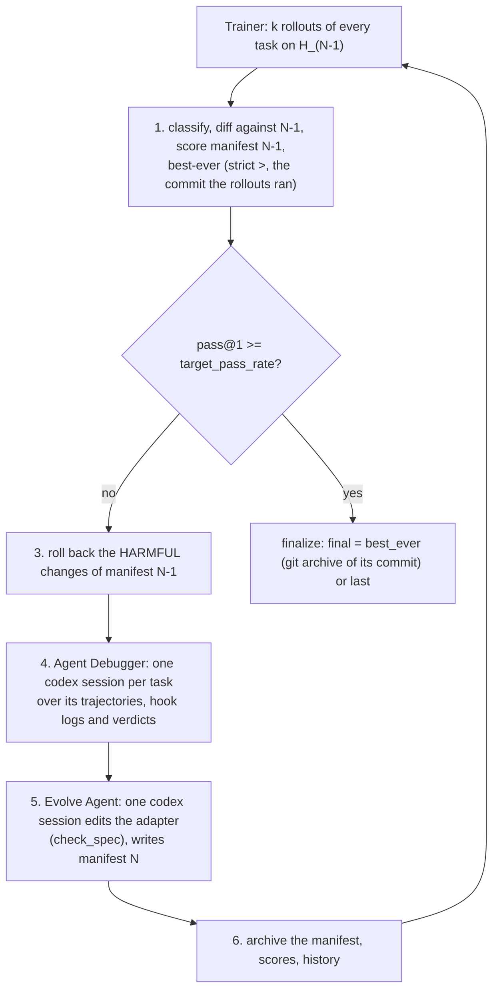

# AHE Adapter

AHE, Agentic Harness Engineering ([Lin et al., 2026](https://arxiv.org/abs/2604.25850),
[code](https://github.com/china-qijizhifeng/agentic-harness-engineering)), evolves a coding agent's harness in a closed
loop: k rollouts per task, an Agent Debugger that distils each task's traces into a report, and an Evolve Agent that
edits the harness and declares every change with the fixes and regressions it predicts, which the next iteration's
rollouts confirm or refute; changes judged harmful are reverted. AHE edits the whole NexAU harness, its tool
implementations and its middleware classes included. **AHE Adapter is AHE's loop confined to an adapter for Codex:**
Codex itself, its agent loop and its tools are fixed, and only the adapter's files change: the system prompt, scripts
the shell runs, a middleware module run as Codex hooks, skills, sub-agents and a long-term memory. Choose it when the
acting agent is Codex, each task can be run k times per iteration, and you want the learner to change more than one
text file under an attributable, falsifiable record of what each change was for.

## Setup

```yaml
template: ahe-codex@1.0
evolver:
  name: ahe_adapter
  params: {task_field: uid, k: 2, rollback: auto}   # the k rows of a task share task_field
  base: codex                                        # the Agent Debugger and the Evolve Agent
  model: {name: gpt-5.6-luna, login: chatgpt, effort: medium}
data:
  train: rows/train_k2.txt   # every training task k times: rows <task>#1 ... <task>#k
  step_size: 100             # one step = one AHE iteration over every trial row
trainer: {epochs: 10, allow_early_stop: true}        # the paper's ten iterations
sandbox: {enabled: true, network: restricted, allow: [chatgpt.com, auth.openai.com]}
```

Both learners are sessions of the `codex` Base Agent: the Agent Debugger one session per task and attempt, the Evolve
Agent one session per step with `check_spec` as its only tool. A task's k rollouts are k rows of the training split
that share `task_field` (a row without it is grouped by its id without the `#n`); the example's `make_rows.py` writes
them. The acting agent must deploy the adapter as `hermit deploy` does for Codex, so that `.codex/hooks.json` runs the
middleware; the Pi host has no hooks.

## The template

`ahe-codex@1.0` (`hermit/adapter/templates/ahe_codex/`) maps AHE's harness components onto files:

| AHE component | File | Learnable |
|---|---|---|
| System prompt and tool guidance | `AGENTS.md` (Codex's instructions; `ADAPTER.md` is kept equal to it) | yes |
| Tool implementations | `scripts/*.py`, run by the shell | yes |
| Middleware | `middleware.py`: functions `session_start`, `before_tool`, `after_tool`, `stop`, `before_model` | yes |
| Skills | `.agents/skills/*/SKILL.md` and their `scripts/` | yes |
| Sub-agents | `agents/*.md` | yes |
| Long-term memory | `MEMORY.md`, handed to the session by the seed middleware at `session_start` | yes |
| The hook runner | `hooks.json` (the `hooks` export), `hook_runner.py`, `hermit_hooks.py` | fixed |

`hooks.json` starts `hook_runner.py` from the adapter's deployed copy on every Codex lifecycle event (SessionStart,
UserPromptSubmit, PreToolUse, PostToolUse, Stop, PreModelRequest). The runner calls the middleware's function for the
event with the task text (the workspace's `task.md`, else the session's first prompt), turns its reply into Codex's
hook output (context to add, a tool call to deny, a stop to block), fails open on any error, and logs every call to
`.hermit-hooks/hook-calls.jsonl` in the workspace, which the Debugger reads beside the session's trajectory.
`.hermit/check.py` requires `AGENTS.md` to keep the paper's three seed rules and to fit Codex's 32,768 bytes once
deployed; `MEMORY.md` its header; `middleware.py` to define the five functions, import only the standard library or
`hermit_hooks`, keep reading `MEMORY.md` at `session_start` and run each function once without an error; skills and
sub-agents their front matter.

## One framework step

Step N is AHE iteration N: step 1 scores the seed, and step N's edits are scored by step N+1's rollouts.

1. Classify every task by its k rollouts (pass, fail, exception), diff against step N−1 (flipped, regressed, rollout
   moves, infrastructure buckets), and score step N−1's change manifest with upstream's rules (EFFECTIVE ...
   HARMFUL). The best-ever record keeps the commit the rollouts ran when their pass@1 is strictly higher.
2. Stop when pass@1 reaches `target_pass_rate` (with `trainer.allow_early_stop`).
3. `rollback: auto`: the files of every change judged HARMFUL are restored from before the change (the paper's
   Algorithm 1), undone again if `check_spec` then fails; `rollback: agent` only reports, as the released code.
4. The Agent Debugger: one Codex session per task over its rollouts' trajectories, hook logs and the judge's verdicts,
   with upstream's query; a failed attempt is retried, and after `retries` upstream's fallback text stands in. The
   reports and an overview go to `state/analysis/step_N/`.
5. The Evolve Agent: one Codex session reads the overview, the verdicts and the history (`START.md` and the evolution
   query on stdin), edits the adapter, and writes `state/change_manifest.json` for iteration N.
6. The manifest is validated and archived, and the iteration's scores and history are updated.



`finalize` hands back the best-ever commit (`final: best_ever`) or the working copy (`final: last`). With no
validation split, best-ever is chosen on the training rollouts, so its training pass rate overstates what the same
adapter scores on held-out tasks; evaluate it on a test split.

## Parameters

```{literalinclude} ../../hermit/agent/evolver/methods/ahe_adapter/evolver.yaml
:language: yaml
```

## Records

Under `<run>/workspace/state/` (and each step's copy, `step_NNNN/state/`): `stats/`, `analysis/step_NNNN/` (the
Debugger's overview, one report per task, its jobs and usage), `queries/` (the Evolve Agent's input), `manifests/`,
`evaluations/` (the verdicts on the previous step's changes), `rollbacks/`, `best_ever.json`, `iteration_scores.md`
and `evolution_history.md`; `<run>/workspace/output/final_selection.json` names the iteration `finalize` handed back.
Each rollout's log holds its `hook-calls.jsonl` and `hook-state/` beside the session's trajectory.

## The authors' implementation against this one

The authors' code is not called: `evolve.py` (4,719 lines) drives NexAU agents in e2b sandboxes through a fork of
Harbor and needs Python 3.13 or later. Its parts are ported per function, each module naming the lines it follows:
the statistics, the diff, the attribution and the overview (`analysis.py`), the Debugger's jobs and attempts
(`debugger.py`), the Debugger's queries, fallback text and the evolution query verbatim (`queries.py`); `START.md`
and `DEBUGGER.md` adapt the Evolve Agent's prompt and the Debugger's rules. The rollback and the trajectory reader are
this framework's own code.

| Dimension | AHE (8b2a55d) | This Evolver | Why |
|---|---|---|---|
| When learning happens | Once per iteration, after k = 2 rollouts of every task; 10 iterations | The same: a step is every trial row, ten steps | Same |
| What the learner sees | The Debugger: each task's traces and verifier output; the Evolve Agent: the overview, per-task reports, verdicts, history | The same, with Codex's session logs and the hook logs as the traces and the judge's verdict and feedback as the verifier output | Framework: Codex's trace format |
| What is learned | NexAU's prompt, tool descriptions and implementations, middleware classes, skills, sub-agents, memory | The adapter's files (the table above); Codex's loop and tools are fixed | Framework: the acting agent is fixed; the reason for the name |
| The update | Edits plus a manifest of predictions, attributed at the next iteration; Algorithm 1 reverts HARMFUL changes, the released code leaves it to the agent | The same manifest and rules; `rollback: auto` (the paper) or `agent` (the code) | Decision: the paper by default |
| Final harness | The best iteration by pass@1 | The best-ever commit, the harness its rollouts ran (Algorithm 1 line 15 names the harness after the next edit, which no rollout measured) | Decision |
| Models and budgets | GPT-5.4 high for every role; the Evolve Agent 500 turns | Config; the Evolve Agent `evolve_timeout_s` 7,200 s, the Debugger 600 s × 3 attempts, 16 at a time | Decision |
| Not ported | — | The Explore Agent (one-shot skill seeding from NexAU's source and coding-agent references); Best-of-N | Decision: no counterpart for a fixed Codex |

## Result

On OfficeQA's GPT-5.6-Luna column, one training: 0.616 on the 172 test questions, +25.0 points [+16.9, +33.1] over
its starting adapter ([example](https://github.com/Infini-AI-Lab/hermit/tree/main/examples/officeqa/ahe_adapter#result),
[recipe](../recipes/officeqa.md#ahe-adapter)).

## What it is not

The Evolve Agent cannot change Codex's own tools or loop: a tool is a script the shell runs, and middleware acts only
through what Codex's hooks allow (add context, deny a tool call, block a stop). The Explore Agent is not ported. The
paper evolves and reports on the same benchmark; on OfficeQA the adapter is trained on the training split and
reported on the held-out test split.
