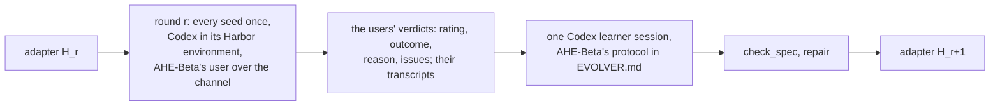

# AHE-Beta Adapter

AHE-Beta, Agentic Harness Engineering Beta: Requirement-Centered Evolution of Agent Harnesses
([arXiv:2611.24924](https://arxiv.org/abs/2611.24924), [code](https://github.com/Curry09/AHE-Beta)), evolves a coding
agent's harness from what simulated users ask for while they work with it, in three parts: user-driven evaluation (a
user simulator follows a persona through multi-turn sessions, sends follow-ups and messages while the agent works,
interrupts it, checks the result with its own commands, then rates the session from 1 to 4 and files the issues it
saw), team-based modification (on a Gitea repository, Triage drops invalid and task-specific issues, an Architect merges
issues that share a root cause into an RFC, a PM mines unstated requirements, developers implement) and
requirement-driven selection (a change merges only when it resolves a verified requirement and passes review; no
verifier result or benchmark score is used while the harness evolves). AHE-Beta edits its whole NexAU seed harness: the
agent's configuration and entry point, its tool definitions, its prompts and parameters. **AHE-Beta Adapter is
AHE-Beta's loop confined to an adapter:** the acting agent (Codex), its loop and its tools are fixed, and only the
adapter's files change: Codex's project instructions, command hooks, helper scripts, skills and roles. AHE-Beta's own
Hermit integration makes the same choice: its handoff to the delivery team names "an external Hermit Adapter deployed
to an unchanged host" as the evolving product. Choose it when the learning signal is a user's (here a simulator's)
judgment of interactive sessions rather than a verifier's score.

## Setup

```bash
PYTHONPATH="$AHE_ROOT/backend" python -m ahe_beta.integrations.hermit.export \
  --experiment "$AHE_ROOT/examples/experiments/u8-mixed-e2b.json" --output <cohort> --cache <material cache>
python examples/ahe_beta_adapter/prepare.py --cohort <cohort> --ahe-root "$AHE_ROOT" --run-id u8-codex
```

`prepare.py` writes the run beside AHE-Beta's export: the rows (`rows.jsonl`: id, Harbor task, instruction), each
session's assignment (`assignments.json`: its persona, scenario and round, read only by the acting agent), the splits
without the sessions it leaves out (a task with a companion container), what the learner is told of the tasks and
their records (`task-info/README.md`) and `run.yaml` (paths shown schematically; prepare.py writes them absolute):

```yaml
template: examples/ahe_beta_adapter/template     # ahe-beta-adapter@1.0
agent:
  name: examples/ahe_beta_adapter/utils/user.py:UserCodexAgent   # Codex in each task's Harbor environment
  base: codex
  params:
    user: {simulate: ahe_user:simulate, assignments: assignments.json, params: {model: ...}}   # AHE-Beta's simulator
judge: {path: examples/ahe_beta_adapter/utils/judge.py, name: user}   # the user's rating, (rating - 1) / 3
evolver: {name: codex, base: codex, params: {tools: [check_spec]}}  # Hermit's Codex Evolver
data: {step_size: <a round's sessions>, shuffle: false}            # one step = one round of the cohort
```

The example's [README](https://github.com/Infini-AI-Lab/hermit/tree/main/examples/ahe_beta_adapter) has the setup
(AHE-Beta's pinned checkout, Harbor, the Codex release mounted into each task's container) and AHE-Beta's own demand
and delivery Evolver (`examples/ahe_beta_adapter/delivery/`: its team in the run's sandbox, not validated end to end).

## The template

`examples/ahe_beta_adapter/template/` (`ahe-beta-adapter@1.0`):

| Path | Learnable | Limits | What reaches the acting agent |
|---|---|---|---|
| `ADAPTER.md` | yes | 32 KB | Codex's project instructions |
| `.codex/hooks.json` | yes | 24 KB | command hooks; Stop hooks without a matcher, run inside the user's Stop hook |
| `scripts/*.py` | yes | 40 files, 200 KB each | helpers the shell runs |
| `.agents/skills/*/SKILL.md`, `.agents/skills/*/scripts/*` | yes | 40 skills, 80 scripts | skills (a `description` in the frontmatter) |
| `agents/*.md` | yes | 20 files | Codex roles (`name`, `description`) |
| `exports.yaml`, `README.md` | no | | what the deployment exports |

`.hermit/check.py` refuses hooks of unknown events, hooks not shaped as Hermit loads them (each event a list of
groups, each hook a `command` hook with a command), a Stop hook with a matcher, an empty `ADAPTER.md` and a script
that does not compile. After every step of the validated route the Trainer checks the adapter against the template and
repairs it (a file outside every path removed, a fixed file restored, a learnable file in a wrong format back to the
parent's); AHE-Beta's own Evolver (`run-delivery.yaml`) refuses a delivery that fails the check instead, and the step
fails with the adapter as it was.

## One framework step



A step is one round of the cohort: every seed once with its persona (`data.step_size` is a round's sessions). Each
session is one `codex exec` in the task's own Harbor environment, led by AHE-Beta's simulator through three Codex hooks
and a root-owned bridge (a message inserted after a tool call, a tool call denied after an interrupt, a Stop that hands
the reply to the user and continues with the user's next message). The judge scores the user's rating and gives the
learner what the user said. The Codex Evolver reads the round's verdicts, the user transcripts and the agent's event
streams (never a persona or the simulator's own records) and edits the adapter following AHE-Beta's protocol in the
template's learner guide (`.hermit/EVOLVER.md`, adapted from its Triage, Architect and PM roles): issues as evidence of
requirements, merged by root cause, changed at the layer that owns the behaviour, with no task names. The next round runs the new adapter; the final adapter is the last step's.

## Parameters

The learner is Hermit's [Codex Evolver](agent.md), with `check_spec` as its only Hermit tool (beside its own files
and shell):

```{literalinclude} ../../hermit/agent/evolver/methods/codex/evolver.yaml
:language: yaml
```

`prepare.py` sets the models (`--actor-model`, `--user-model`, `--learner-model`: a Codex model name on the ChatGPT
login, or a `<backend>/<model>` reference) and their efforts; the user's options (`user.wait_s`, `exit_wait_s`,
`review_s`) are in `utils/user.py`'s docstring.

## Records

Each rollout's log holds `user-transcript.jsonl` (every message, reply and tool event the user could see),
`user-verdict.json` (the visible verdict) and, for a session the user rated, `user-reward.txt`; the simulator's own
records (its session, the persona, its private checks, AHE-Beta's full outcome) stay under the acting agent's
`<workspaces>/user/<session>/`, outside every log, and its usage ledger beside them (`user-model/usage.jsonl`).

## The authors' implementation against this one

| Dimension | AHE-Beta (43b165f) | AHE-Beta Adapter | Why | Open? |
|---|---|---|---|---|
| When learning happens | after each round: every seed once with its persona; five rounds learn, the sixth is observed | the same: one step is one round (`step_size`: the round's sessions), one epoch; the last round is the evaluation split | Same | no |
| What the learner sees | Triage: issues with their evidence, interaction records, harness logs; PM: ratings and summaries; never a persona prompt or a verifier | the users' verdicts (rating, outcome, reason, issues), their transcripts, the agent's event stream; no persona and no simulator record; the task's verifier verdict is recorded with each rollout (AHE-Beta's exported tasks only copy the user's rating) | Framework: the learning material | no |
| Each component's carrier | NexAU's whole seed harness: configuration, entry point, tool definitions and their code, prompts, parameters; written by the developer agents | the adapter's files (the table above): instructions, command hooks, scripts and skills, roles; written by the learner only; Codex's loop, tools, context handling and sampling fixed | Framework: the acting agent is fixed; the reason for the name | no |
| The update | requirement-driven: Triage, the Architect's RFC, the PM, admission, developers' pull requests, review; a change merges only for a verified requirement | one Codex learner session with AHE-Beta's protocol as text (`.hermit/EVOLVER.md`), `check_spec`; every step kept, no gate, no rollback | Decision: the validated route; AHE-Beta's own pipeline is in the example, not validated | yes: requirement-driven selection |
| User simulation | its persona loop, private checks, terminal review | the same code, its transport Hermit's channel in each task's Harbor environment | Same | no |
| Tasks and runtime | 32 seeds; U8, U16 and U32 over six rounds; E2B sandboxes with internet access | the same cohorts as Harbor task directories (local Docker, the public network), without the sessions whose task needs a companion container (one a round in U8 and U16, two in U32) | Framework: a Hermit environment does not reach a companion container yet | yes: companion containers |
| Models and budgets | GLM-5.3-Flash acting and user, GLM-5.3 team, Claude Code developers; the recipes' budgets | configuration (GPT-5.6-Luna on a ChatGPT login by default, GLM-5.3-Flash by reference); the exporter's budgets, Codex's clock ending `review_s` before the deadline | Decision | no |
| What is not ported | | the held-out evaluation suite (38 Harbor-index tasks), its evaluation persona, the human A/B study | Decision | yes: the held-out evaluation |

## Result

No experiment of the paper's has run yet. The runs so far check the route end to end on real models: the channel's
smoke, AHE-Beta's simulator on one seed, and four U8 seeds over two rounds with one Codex Evolver step, whose ratings
(4, 3, 3, 3, then 2, 3, 3, 4) four sessions a round cannot tell apart
([validation](https://github.com/Infini-AI-Lab/hermit/tree/main/examples/ahe_beta_adapter#validation)).

## What it is not

The learner cannot change Codex's own loop, tools, context handling or sampling: a tool is a script the shell runs or a
skill, and a behaviour at run time acts only through what Codex's hooks allow (add context after a tool call, deny a
tool call, block a stop). The validated run (`run.yaml`) gives the learner AHE-Beta's protocol as text; it has neither
AHE-Beta's team nor its requirement-driven selection, which only `run-delivery.yaml` runs (not validated end to end).
The held-out evaluation is not packaged.
