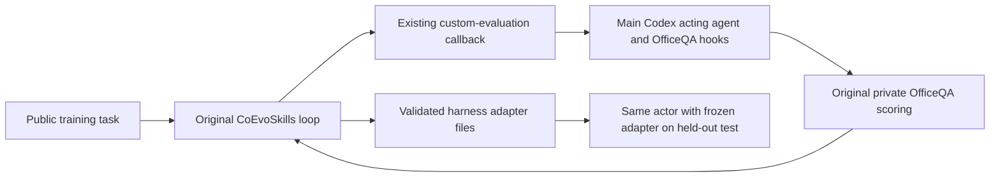

# CoEvoSkills for the fixed OfficeQA actor

This integration learns a harness adapter for the repository's existing
built-in `codex` acting agent with `examples/officeqa/utils/task.py`. The acting agent is fixed. The original CoEvoSkills
Generator/Verifier loop is imported from commit
`4380d4bff673dd6e1d58e5babeb2aaa0fe527119`; the integration does not rewrite its
prompts, evolution decisions, verification thresholds or rollback logic.

There is one Evolver, `coevoskills`, and one template, `coevoskills@1.0`.
The only benchmark integration is OfficeQA; SkillsBench datasets, native actors
and benchmark preparation scripts are not loaded.
The learning step updates only `skills/<training-id>/evo-*/**` in the adapter.
The existing OfficeQA seed supplies its initial context. A fixed adapter reader
selects relevant Skill manifests; the original actor deploys and reads the
adapter through its existing interface.

## Boundaries



The upstream `COEVOSKILLS_CUSTOM_AGENT_IMPORT_PATHS` extension supplies a thin
measurement callback. That callback uses Hermit's existing `run_agent` tool to
call the public OfficeQA actor; it has no model or acting loop. Only the actor's
prediction is copied to the evaluation fixture. Reference answers and judge
feedback do not enter model completions. Hidden training pass/reject feedback
remains part of the upstream method.

Two integration seams are used: model construction and Docker environment
construction. Model completions use main's `codex` Base Agent for session homes,
stdin, cancellation, logs and usage, without a second CLI launcher. Generator
and independent Verifier keep their original separate histories, parser and control flow. Token counting uses the same function as
upstream. The CLI receives the full serialized conversation as text, rather than
the original API message-role interface. Full histories are given on stdin using
the Base Agent’s long-input support. CLI effort and completion time limits are
explicit configuration; API temperature/output caps are not emulated. These
transport differences must accompany any comparison to the published method.

Known fixture paths in exported Skills are projected deterministically into the
public actor’s deployed adapter folder (`hermit/coevoskills/`). The shared host
deployment supplies that folder, and examples refer back to the session corpus.
Raw exports and per-file source/deployment hashes are
retained. Solver logic and canonical answers are not edited. A changed deployed
Skill raises an execution error; the callback never rewrites the judge's score.

## Docker isolation

Acting sessions, evolution fixtures and fresh evaluation fixtures all run with
Docker `network_mode: none`. An environment-only Docker launch policy preserves
the original acting command, image, user and resources while adding a read-only
Unix-socket model relay. The container has only loopback, with an authenticated
endpoint for the configured model. The backend key stays on the host. The relay
uses the project’s standard model-backend binding. With `login: chatgpt`, main's
native login handling supplies the session credentials instead; the relay forwards
only model catalogue, Responses/compaction and token-refresh requests to fixed
provider endpoints. The same Base Agent uses its model-provider configuration
with native ChatGPT credentials; no second login parser or refresh implementation
is used. It does not expose a host-wide CONNECT proxy.
Arbitrary HTTP routes, CONNECT and hosted web/execution tools are rejected.

The trusted controller runs outside Docker. Each model completion runs in a
separate, empty, read-only Docker session with network none and the model gateway.
Model-returned terminal
commands are executed by the original upstream parser in the offline fixture.
Images and dependencies are prepared separately before execution. No online
runtime fallback or grading-script rewrite is provided.

Source/image checks run before evaluation. Containers reuse the existing
`sandbox_relay.py`: it checks the forwarded port and blocked external TCP before
starting the command. Docker network none leaves only loopback. Adapter integrity
uses main’s deployment check; source fingerprints are checked during execution.
The original repository’s actor and judge files are unchanged.

## Protocol and setup

OfficeQA retains the existing 50/24/172 training/validation/test boundaries.
Validation is not used for model selection. The final Skill bank is frozen on
the 172 held-out questions and compared with no adapter and the unchanged seed,
using the same actor, model, effort and per-task limits. This frozen transfer
protocol differs from the paper's task-local test adaptation; no published-score
reproduction is claimed. Training rollouts and oracle passes are not test acc.

See [the example](../../examples/officeqa/coevoskills/README.md) for dependencies,
preparation and execution. Tests cover fixed-source identity, adapter-only updates,
private-data boundaries,
the original evaluation hook, rollback, and CoEvoSkills-specific Docker and gateway
wiring. Generic isolation is covered by the repository’s shared sandbox tests;
this method does not maintain another network-probing implementation.

```{literalinclude} ../../hermit/agent/evolver/methods/coevoskills/evolver.yaml
:language: yaml
```
