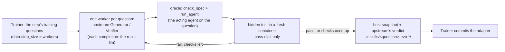

# CoEvoSkills Adapter

CoEvoSkills Adapter is the Generator/Verifier loop of CoEvoSkills (Zhang et al., 2026,
[arXiv:2604.01687](https://arxiv.org/abs/2604.01687); [code](https://github.com/Zhang-Henry/CoEvoSkills) at
`4380d4b`) with the search confined to the adapter. For one task at a time, a Generator writes an executable Skill
package (a `SKILL.md` with its scripts) in the task's container, a Verifier reviews it, and a fresh agent runs the
task with the package; the task's hidden tests decide pass or fail, only that verdict returns to the loop, and the
loop revises the package up to a fixed number of checks. Choose it when the acting agent should gain reusable,
executable procedures (scripts it runs, not only instructions it reads) and the tasks have a checkable answer.

**What it is not.** CoEvoSkills evolves a Skill for the task it is then used on (task-local), with its own executor in
the task's container. Here the acting agent is fixed: the fresh executor is the task's own acting agent and judge,
reached through the Trainer, and every package learned on a training question is kept in one adapter, whose packages
the acting agent receives as its native skills on every test question. The packages are learned on the training split
and evaluated frozen on the test split, so the result measures transfer, not the paper's task-local adaptation.

## Setup

Install the `coevoskills` dependency group (`python -m pip install -e . --group coevoskills`, pip 25.1 or newer)
and keep an unmodified checkout of the upstream repository at the pinned commit; `evolver.params.upstream_root`
(default `$COEVOSKILLS_ROOT`) names it, for its prompts, its meta-skills and its `scripts/`. The loop's task
containers need Docker. The run's `llm` is the model of every upstream role. The task supplies three things through
its example: a Harbor task package per training question (the question, its container, and the hidden test with
the reference answer, which only the oracle's container receives), `deliver` (the hook that writes the acting agent's
output where the hidden test reads it) and `path_map` (the task container's paths in the acting agent's workspace).
The acting agent's collection hook must also call `record_deployment(workspace, log)` from the method's
`integrity` module so an oracle can validate the candidate after the workspace is released.
Before the first rollout `setup` checks the parameters, that the run has an `llm`, Harbor and the checkout (pinned
commit, no local change in `libs/`, `scripts/` or `meta_skills/`), that the package directory holds packages, and
that `deliver` loads. The acting agent's host must install the `skills` export natively (Codex, Claude Code).

## The template

`coevoskills-adapter@1.0` holds the starting context (`ADAPTER.md`) and the packages as the framework's `skills`
export: `skills/<task>-evo-<name>/`, one directory per package, each checked against upstream's Skill schema
(`.hermit/skill_schema.py`, vendored unmodified: the frontmatter `name` equals the directory). The host installs them
as the acting agent's native skills (Codex: `.codex/skills/` of the session's workspace), so the agent sees every
package's name and description and opens and runs the ones it chooses, as upstream's own executors find their Skills.
The paths in a package follow the deployment's convention, which the deployed context states: relative to the
adapter's folder in the workspace (`hermit/coevoskills-adapter/`, which holds `skills/` too).
Portability covers literal path references in UTF-8 files. A script that constructs a container path at runtime
may still require adaptation.
No existing template fits: `prompt-only` has no executable packages, and `harness2-codex` and `meta-harness-adapter`
let the learner change files beyond the packages. The Evolver never edits `ADAPTER.md` or `exports.yaml`.

## One framework step



Each question starts an independent worker process with the same seed. Up to `workers` processes can run concurrently.
They share the run's budget, so deadlines and concurrency can affect which questions complete. A worker copies the question's
package without its `solution`, sets `allow_internet = false` (Harbor then runs the container with network none),
and runs Harbor's Trial with the pinned evolution agent. The integration supplies the model
class (each completion becomes a call of the Trainer's `llm` tool, with the role's temperature and output cap), its
custom-oracle hook (the oracle makes the candidate the skills of a copy of the adapter without packages, checks it
with `check_spec`, runs it on the question with `run_agent`, and writes the acting agent's output through
`deliver`), and its Docker environment (cleanup leaves the images alone). It also adjusts the host-side export
and rollback to retain the selected package set. Harbor copies the manifest, scripts and references as files,
including binary content, nested paths and executable permissions. The worker compares two downloads to detect a
package that changes during export. The worker writes the
selected packages to `loop/selected-skills/` and captures upstream's final verdict, including when a later timeout or
agent error ends the loop. The Evolver installs the snapshot's packages, renamed after the question, and records
the verdict and the loop's error. A question whose loop left no valid package, or whose package cannot be installed
(a name another question's skill has, or one the template check refuses: the install is all or nothing), leaves the
adapter as it was; the step fails only when none of its loops produced a package (with `keep: passed`, a step whose
packages all failed upstream's verdict is done and leaves the adapter unchanged). Each worker copies its question's
package under a name of its own, which Harbor gives the containers and the image of that question, and after the
worker the Evolver removes exactly those (each Docker command with a clock; a failure is recorded). A worker has a
clock of its own, `worker_timeout_s`: upstream's loop clock cannot interrupt a model call in progress, which blocks
its event loop. The acting agent's collection hook checks the deployed adapter and native skills in the workspace
and writes a fingerprint to `coevoskills-integrity.json` in its log. The oracle compares the fingerprint with its
candidate. The template check covers the complete bank before ownership of the installed skills is recorded.
Finalization returns the last adapter.

## Parameters and defaults

```{literalinclude} ../../hermit/agent/evolver/methods/coevoskills_adapter/evolver.yaml
:language: yaml
```

## Where this integration departs from the authors' code

| Dimension | CoEvoSkills (`4380d4b`) | CoEvoSkills Adapter | Kind | Status |
|---|---|---|---|---|
| When learning happens | task-local: the Skill is evolved on the task it is used on | once per training question; the frozen adapter is evaluated on the test split | decision (transfer under the column's split) | acceptable |
| What the learner sees | the task, its container, the Verifier's review, pass or fail of the hidden test | the same; as in upstream's tasks the container holds the instruction (with where the answer goes) and a background document, which for OfficeQA is the task's own description (`task-info/README.md`, nothing added: upstream's documents are written per task by its authors, and OfficeQA is not one of their tasks); the reference answer stays in the hidden test, the judge's feedback is not passed on | task | acceptable |
| The task container's network | as the task configures it (`allow_internet = true` in the authors' tasks) | always none (`allow_internet = false`): the Generator cannot install packages or fetch anything | decision (the column's isolation) | acceptable |
| The fresh executor (oracle) | a Claude Code (or other) agent with the Skill only, its instruction extended with a hint to use the Skill and code examples; the Skill immutable during the run | the task's own acting agent and judge through `run_agent`, with the task's own prompt (upstream's hint is not given), its output written where the hidden test reads it; after the run the deployed copies are checked against the candidate (the framework's deployment check and the native skills), a change making the check an error | framework (the acting agent is fixed) | acceptable |
| Each component's carrier | Skill packages in the task's container | the same packages as the adapter's skills, `skills/<task>-evo-<name>/`; the container's paths rewritten to the installed skill's and the workspace's (`packaging.py`) | framework | acceptable |
| What the acting agent sees | the task's own Skill, by the agent's native skill discovery | every training question's packages, by Codex's native skill discovery (names and descriptions listed, a package opened on demand) | decision (the per-task Skills transfer) | acceptable; it decides what the result measures |
| The update | Revise the skill until the hidden test passes or the check budget expires. Upstream selects its best snapshot. Its final host copy omits reference files, and rollback can leave additional packages from a later revision. | Retain the selection rule. Copy reference files and restore the complete selected bank on rollback to preserve the contents of the snapshot selected by upstream. The default `keep: all` installs an exported snapshot even after a failed verdict. Select `keep: passed` to require a pass. | framework | Export differs from the pinned code. |
| Models | LiteLLM sends role-specific temperatures (Generator 0.7, independent Verifier 0.3) and the requested output cap to the provider. It can drop unsupported settings and retry rate limits and empty responses. | The API recipe forwards the temperature and output cap to the configured model. In the Luna recipes each completion runs as one Codex session at medium effort. The endpoint records the output cap and the explicitly accepted `llm.unapplied: [temperature]` as unapplied. The independent Verifier therefore uses the same sampling configuration as the Generator. The shared client controls retries. | framework | API and CLI runs have different sampling behavior. |
| Budgets and clocks | per task: checks, episodes; the task's agent timeout bounds both the whole loop and each oracle check | the same checks and episodes (`max_iterations`, `max_episodes`); the loop bounded by `task_timeout_s` (7,200 s), each oracle check by the package's agent timeout (OfficeQA: 4,500 s, an acting session and its start); each worker by `worker_timeout_s` (12,600 s), since upstream's clock cannot interrupt a model call in progress; the Trainer's budget and call clock | decision (an acting session's clock) | acceptable |
| Extra work | — | before each step the Trainer runs the acting agent on the step's questions with the current adapter (the run's training curve), charged to the budget; the loop does not read these runs | framework (the Trainer's step) | acceptable |
| What is not ported | — | the paper's benchmarks and their native executors | task | open |

## Records to read after a run

Under the run's `step_NNNN/output/`: `questions.json` (each question's outcome, upstream's final verdict, the loop's
error if any, whether and as which skills it was installed), and per question `loop.log`,
`loop/upstream-result.json`, `loop/evolution/` (upstream's trial: the Generator's and Verifier's episodes, the
oracle's checks, `agent/evolution_run_log.json` with the final verdict) and `portability.json` (each file's
rewrites). `state/installed.json` names each question's skills. The `llm` calls are in the run's `tools.jsonl`; the
oracle's acting runs are ordinary `run_agent` runs.

## Limits

- The pinned Python worker runs on the trusted host and drives Docker. Its environment includes Docker client
  settings and excludes model API keys. It can still access the host filesystem and Docker daemon. Model calls go
  through the Trainer. The task containers run without network access. Harbor supplies the hidden test and
  reference answer to the oracle's container during scoring.
- The Trainer signals its cancellation to the worker process group and to shared calls that support it. A worker
  or per-oracle deadline may close the local client while a request is already executing in the Trainer. A worker
  timeout alone provides no guarantee that the model call or acting session has ended.
- Upstream can take another snapshot of the Generator workspace after a probe finishes. The receipt identifies
  the candidate used by that probe. A later export has its own file hashes. Comparing the two is required to
  claim they are byte-identical.
- The collection check compares the final contents and executable permissions of the deployed skill copies.
  A file changed and restored within the session produces the same fingerprint.
- A held-out OfficeQA run freezes the source adapter across questions. Its standard judge scores the answer even if
  the acting agent changes a copy in its disposable workspace. Inspect the logged integrity receipts for such
  changes when reporting results. The training oracle requires a successful receipt to accept its probe.
- The acting agent's host must install the `skills` export natively (Codex, Claude Code). A correct answer and an
  intact deployment establish that the agent had access to the candidate. Check the session's tool calls to
  establish whether the agent actually opened a skill or ran a helper. The copy of the oracle's
  acting log into upstream's trial reads Codex's stream and is skipped for another host.

## Example

[OfficeQA](../recipes/officeqa.md#coevoskills-adapter): `examples/officeqa/coevoskills_adapter/`, with GLM 5.3 Flash
configs (`run_codex.yaml`, `smoke_codex.yaml`) and GPT-5.6-Luna configs (`run_codex_luna.yaml`,
`smoke_codex_luna.yaml`). No result is recorded yet: the earlier run was made with a different harness and is to be
repeated with this one.
