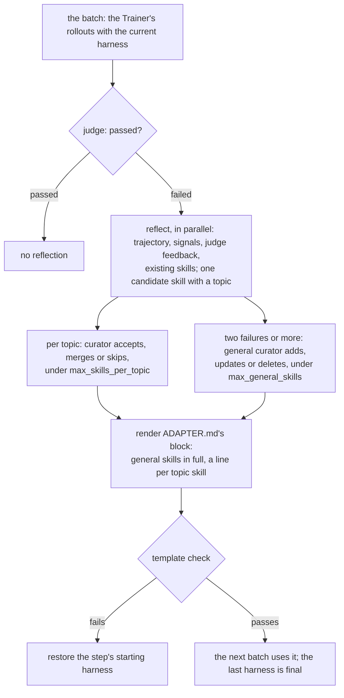

# Evo-Harness

Evo-Harness, context-to-harness skill compilation ([Wei et al., EMNLP 2026](https://arxiv.org/abs/2608.15071),
[code](https://github.com/A-EVO-Lab/a-evolve/tree/release/evo-harness)), studies online harness learning: a frozen agent
improves only through a harness of skills updated over a stream of task batches. Failed executions are reflected on
into candidate skills, and a compile step filters, merges and promotes them at two levels: task-type skills under topics
and general cross-task skills. Choose it when tasks arrive as a stream, each can be judged once, and you want the
learned guidance kept as inspectable skills. In this framework the agent picks its topic skills by their descriptions,
where the paper's selector is a model call per task.

## Setup

```yaml
template: evo-harness@1.0
evolver:
  name: evo_harness
  params: {feedback_level: standard, max_general_skills: 5, max_skills_per_topic: 5}
data:
  step_size: 16          # the paper's batch
llm: {model: <backend>/<model>}   # the reflections' and the curators' model
```

Both protocols are this configuration. Online, the stream is the training split and its own answers are the result;
train / test, the last harness is evaluated frozen. On a model reachable only through a ChatGPT login, `llm: {cli: codex}`
makes each call one Codex session.

## One framework step



`state/evo_harness.json` records each step's proposals and curation; each step's `output/calls/` holds every prompt and
reply.

## Parameters

```{literalinclude} ../../hermit/agent/evolver/methods/evo_harness/evolver.yaml
:language: yaml
```

## The authors' implementation against this one

The authors' code is not called: `evo_harness/*.py` are benchmark scripts bound to Amazon Bedrock clients and their own
solvers, with no function that takes a model or a trajectory from outside, so `evolver.py` ports
`evo_harness/swe_bench.py` (release/evo-harness, `3c7c7b8`) function by function, each naming the upstream function. The
pipeline with topics and the paper's defaults is the SWE-bench one; the prompts are `terminal_bench.py`'s, the release's
task-neutral wording (`NOTICE` says what changed).

| Dimension | A-EVO-Lab/a-evolve (3c7c7b8) | This Evolver | Forced by, and status |
|---|---|---|---|
| When learning happens | After each batch of 16; shuffled with seed 42 | The same after each step; `data.step_size`. OfficeQA's stream uses the seed-0 order of the framework's other streams | Decision: joins their row. Acceptable |
| Reflection's input | Continues the solver's own conversation, with signals, a compressed trajectory and the evaluation | One learner call with the task, the answer, the trajectory (middle cut past `trace_chars`), signals and the evaluation | Framework: a finished session cannot be resumed from an Evolver. Acceptable |
| What reaches the agent | General and selected topic skills in full in the system prompt; a selector call picks topics for each task | General skills in full in `ADAPTER.md`; topic skills as host skills, listed by description (upstream's `--lazy-load`), which the agent opens itself | Framework: an adapter's context cannot make a model call per task. A difference to keep in mind when reading results |
| Judge verdict | An LLM judge scores the trajectory for the reflection | Not called; upstream's "No judge assessment available" text; the real judge's feedback is in the evaluation | Decision: the grounded feedback is already there. Acceptable |
| Feedback | `standard`: the evaluator's output, 500 characters | The judge's feedback, 500 characters: on OfficeQA it names the expected answer | Task. As supervised as the paper's Standard setting, not label-free |
| Carrier | `skills/topic/<topic>/<name>/SKILL.md`, `skills/general/<name>/SKILL.md` | `skills/<topic>--<name>/SKILL.md` (a host's skills are one level deep), `general/<name>/SKILL.md` not deployed as a file; descriptions JSON-quoted (a colon would make Codex drop the skill), `<topic>--<name>` cut to 64 characters (Codex skips a longer name) | Framework. Acceptable |
| The update | Whole-skill writes by the curators; no gate | The same; a harness failing the template check is rolled back | Framework |
| Selection | None | None: the last harness is final | Same |
| Models | Claude Opus 4.6 solver and curator, Sonnet 4.5 selector | The acting agent and `llm`; OfficeQA: `gpt-5.6-luna`, medium | Decision: OfficeQA's setting |
| Budgets | 1,536 / 2,048 / 4,096 tokens by role, temperature 0.3 / 0 | The run's `llm`; on a Codex session neither applies | Framework |
| Not ported | `--evolve-all` (reflecting on passes), `--agent-evolve`, `--agent-curate`, seed skills (off in the paper's launchers), the benchmarks | — | Outside the paper's main setting |

## What it is not

Topics are unbounded: the budgets are per topic, and reflections of one batch run in parallel, so they cannot see each
other's new topics. Nothing is validated, so a harness that got worse is kept.
