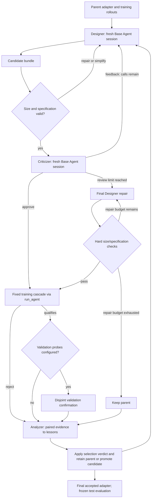

# EvoSafeHarness

This is a **fixed-case AgentDyn adapter-search variant**, with restricted archive access, a partial warm
start and a fixed auxiliary classifier. See the [component comparison and execution boundary](https://github.com/Infini-AI-Lab/hermit/blob/main/examples/agentdyn/evosafe/REPRODUCTION.md).
Old measurements made with task-specific guidance do not validate this revision.

EvoSafeHarness ([paper](https://andylinx.github.io/EvoSafeHarness/assets/EvoSafeHarness_paper.pdf),
[code](https://github.com/SaFo-Lab/EvoSafeHarness), [website](https://andylinx.github.io/EvoSafeHarness/))
secures a tool-using agent without changing its model. It keeps the victim model frozen and searches a **defense
bundle** around it: a system-prompt surface (`ADAPTER.md`) and executable tool-call hooks (`defense.py`). Each
candidate is written from the victim's own failure traces and kept only when it measurably improves
`utility − ASR`. Four parts run the search: a **Designer** proposes one mechanism, an independent **Criticizer**
reviews it, a **Cascade** scores it, and an **Analyzer** turns the results into lessons for the next proposal.

In Hermit the method is the `evosafe` Evolver with the `evosafe@1.0` template. It does not depend on any benchmark:
a domain plugs in through the [task contract](#the-task-contract). The first domain is
[AgentDyn](https://github.com/SaFo-Lab/AgentDyn), in
[`examples/agentdyn/`](https://github.com/Infini-AI-Lab/hermit/tree/main/examples/agentdyn).

| Layer | Where |
|---|---|
| Method (Evolver, roles, gates, task contract, hook SDK) | `hermit/agent/evolver/methods/evosafe/` |
| Defense bundle template | `hermit/adapter/templates/evosafe/` |
| AgentDyn integration (environment bridge, victim, judge, case preparation) | `examples/agentdyn/utils/` |
| EvoSafe run configs on AgentDyn | `examples/agentdyn/evosafe/` |

## Setup

```yaml
template: evosafe@1.0
agent: {name: ../utils/bridge.py:run, base: direct, model: vllm/nvidia/nvidia/nemotron-3.5-lightning}                # the domain's hook bridge
judge: {path: ../utils/judge.py}                    # native verdicts as metrics in JudgeResult.extra
evolver:
  name: evosafe
  base: codex
  codex: {model: gpt-6-sol, web_search: false, timeout_s: 1500}
  params:
    search_mode: roles
    gate_mode: source
    cascade_sizes: [12, 57]
    eval_task_ids: [...]                             # training cases
    robustness_task_ids: [...]                       # validation cases
```

A full config is [`examples/agentdyn/evosafe/run_nemotron_codex.yaml`](https://github.com/Infini-AI-Lab/hermit/tree/main/examples/agentdyn/evosafe/run_nemotron_codex.yaml).
The method does not generate attacks; it replays existing frozen cases.

## Agent layers

The AgentDyn Acting Agent keeps its native task/tool loop in `examples/agentdyn/utils/bridge.py`. Every victim
turn, including the optional frozen-model classifier, calls a `direct` Base Agent; its Layer 1 is Hermit's
`ChatClient` with the resolved backend, request timeout, retries and price. AgentDojo's message converters are
reused, but the OpenAI SDK no longer sends requests. Bare native AgentDyn model names without backend settings
are no longer accepted: configure `agent.base: direct` and `agent.model: <backend>/<model>`.

The Evolver keeps Designer/Criticizer/Analyzer orchestration and all selection gates in Layer 3. Each role calls
`make("claude" | "codex" | "pi", settings).run(...)` with read-only TRAIN archive tools and a fresh session. Base Agents
own process cleanup, cancellation, timeouts, configuration, login-plan scheduling and usage. The role's JSON schema
is given to Codex as `--output-schema` and to Claude and Pi in the prompt, all through the Base Agent's existing settings,
and the reply is validated against it in Layer 3; a refusal is read from the Base Agent's own `model_refusal` (Claude
Code's and Pi's), else from the reply and the trajectory's error steps, and is never retried. The normalized
trajectory of each role is archived. Claude's built-in tools are disabled (`--tools ""`), and
so are Pi's (`--no-builtin-tools`); Codex has web search disabled, a read-only sandbox by default, an ephemeral session, and instructions to use only the supplied TRAIN readers. Codex's read-only mode does not hide files; use the shared isolation settings for a filesystem boundary.

`evolver.base`, `evolver.model` and `evolver.claude`/`evolver.codex`/`evolver.pi` are the preferred configuration. Legacy
`proposer`, `claude_model`/`codex_model`, binary and timeout settings remain accepted when the corresponding
shared setting is absent. For `proposer: llm`, the existing metered Trainer `llm` tool already calls `direct`.
No extra usage is added for that path; CLI usage is returned once in `StepResult`.

The method changes nothing in the Hermit core; [`FRAMEWORK_SUPPORT.md`](https://github.com/Infini-AI-Lab/hermit/blob/main/examples/agentdyn/evosafe/FRAMEWORK_SUPPORT.md) lists what could become shared
support later.

## The task contract

A domain provides four things:

1. **Case fields** on every task row: `kind` (`clean` or `injected`), and optionally `group` (the cases of one user
   task, kept in one split) and `domain` (a stratum for balanced evaluation).
2. **A judge** that returns `{kind, utility, attack_success}` as `metrics` in `JudgeResult.extra`, and raises
   for an episode the pipeline reports as failed (so the run is recorded as failed, with its usage and log).
   The defense metrics are computed from the run records by the method's `contract.py`.
3. **A hook bridge** as the task pipeline. It builds the bundle's `Defense` once per episode and calls its hooks
   around every tool call, as the template's `.hermit/EVOLVER.md` specifies. Hooks see the trusted instruction and
   public tool schemas, never task IDs, labels or judge state.
4. **A domain specification** in `task_info` (`README.md`, `tools.json`), which every role receives.

To add a domain, follow `examples/agentdyn/utils/` and copy the AgentDyn run config.

## The step

1. Hermit rolls the current bundle out on the step's training cases. The search reuses these rollouts only when
   every case completed and its case/adapter provenance matches; otherwise it measures the parent again.
   Configured error policies bound incomplete parent/candidate measurements conservatively during selection.
2. For up to `max_proposals` trials, the Designer uses the accepted parent as its measured reference and
   may redesign the prompt, pre/post hooks and session state together around a transferable hypothesis.
   There is no preference for short code or small edits. It receives explicit UTF-8 file budgets;
   `defense.py` defaults to 32,000 bytes through
   `max_defense_bytes`, capped by the template's limit. Oversized or specification-invalid proposals go directly
   back for repair without a Criticizer call, with up to `spec_repair_attempts` extra repairs per candidate.
   The Designer may simplify, delete or replace the mechanism instead of adding task-specific branches.
   A fresh Criticizer reviews valid proposals against the parent and their stated hypothesis. Concrete
   execution/interface errors, isolation violations, benchmark-dependent rules, demonstrated task blockers
   and defects in the mechanism's own invariant receive prioritized correction requests. Unmeasured utility
   concerns and uncertain generalization or incomplete coverage are advisory.
   Each candidate gets at most `min(3, review_revisions + 1)` Criticizer calls, with no role retries for that
   session. Approval permits immediate evaluation. Otherwise the last feedback goes to a final Designer repair;
   if that version passes the hard size/specification checks, it proceeds without another approval. Exhausting
   the static repair budget keeps the parent. The last Criticizer verdict is retained, and the report explicitly
   marks a final revision admitted without approval; this is not a security certification.
3. An eligible candidate is scored on the training cases. With `gate_mode: source`, the source method's gates
   apply:
   - an intermediate stage needs utility ≥ 0.7× and ASR ≤ 1.3× the parent's (the source compares with its fixed
     no-defense bundle instead, and allows 5% ASR when that bundle's ASR is zero; here a parent with zero ASR
     allows none);
   - promotion needs a gain in `utility − ASR` above `min_improvement`;
   - when validation probes are configured, their objective must be within `validation_tolerance` of the parent's.
4. The Analyzer records lessons for the next trial. A promoted candidate becomes the parent.

CLI roles receive two read-only tools, `list_training_experience` and `read_training_experience`, through the
shared Base Agent tool server. The persistent TRAIN archive contains every explicitly registered parent and
candidate outcome, complete observable trajectories and hook/classifier audits when recorded, proposed
source versions, reviews, measured comparisons and lessons. Roles can page through any registered document;
the initial summaries and nine highlighted dossiers do not limit which samples they can inspect. Missing
logs remain missing, and a partially evaluated candidate is labelled with its measured episode count.
No filesystem path, arbitrary command, model API or attack-generation capability is offered by these tools.
Validation/test trajectories are excluded; in TRAIN-cascade searches, learner-facing trial summaries omit
independent validation probe scores. Legacy validation-only selection retains its supplied selection metrics.

The next Designer receives rejected source as experience, without installing it as the parent. It may reuse
or replace useful parts. Initial summaries default to 2,000 characters per case; large CLI previews move
behind the TRAIN reader before exceeding the CLI input budget. Analyzer input carries parent outcomes once,
avoiding the duplicate evidence that exceeded the CLI's input limit in an earlier live run. The plain `llm`
backend retains supplied evidence but does not provide interactive archive tools.

Search reports distinguish static rejections from independent reviews. The review cap, file budgets and
training/validation promotion criteria remain enforced. The
[AgentDyn results summary](https://github.com/Infini-AI-Lab/hermit/blob/main/examples/agentdyn/evosafe/README.md#results)
reports the fixed-case comparison. The
[evaluation protocol](https://github.com/Infini-AI-Lab/hermit/blob/main/examples/agentdyn/evosafe/REPRODUCTION.md#evaluation)
describes the split, metrics and generated records.



## Parameters

```{literalinclude} ../../hermit/agent/evolver/methods/evosafe/evolver.yaml
:language: yaml
```

## Integrating with Hermit

The training loop and the core are unchanged; the whole search runs inside one `Evolver.step()`. A defense
objective has separate denominators that a mean of scalar scores cannot express, so the judge's per-episode
verdicts travel in `JudgeResult.extra` and the method's `contract.py` computes the objective from run records.
`hermit eval`'s `mean_score` is therefore not a defense metric: report an evaluation with
`examples/agentdyn/utils/report.py` or `compare.py`. See [`FRAMEWORK_SUPPORT.md`](https://github.com/Infini-AI-Lab/hermit/blob/main/examples/agentdyn/evosafe/FRAMEWORK_SUPPORT.md).

## What it is not

- The original's adaptive and renamed-payload robustness probes are not ported. Validation replays fixed cases.
- DTAP seed bundles (DRIFT, CaMeL) need an explicit port to this hook contract.
- In the AgentDyn bridge, learned hooks run in a separate Docker container, with bounded JSON RPC to the
  trusted process that owns native tools and judging. This does not containerize the entire framework or
  learner orchestration. See the [execution boundary](https://github.com/Infini-AI-Lab/hermit/blob/main/examples/agentdyn/evosafe/REPRODUCTION.md#execution-boundary).

## Example

[`examples/agentdyn/evosafe/`](https://github.com/Infini-AI-Lab/hermit/tree/main/examples/agentdyn/evosafe) runs the
setup on AgentDyn with a Nemotron 3.5 Lightning victim and Codex or Claude roles.
See the [results summary](https://github.com/Infini-AI-Lab/hermit/blob/main/examples/agentdyn/evosafe/README.md#results).
