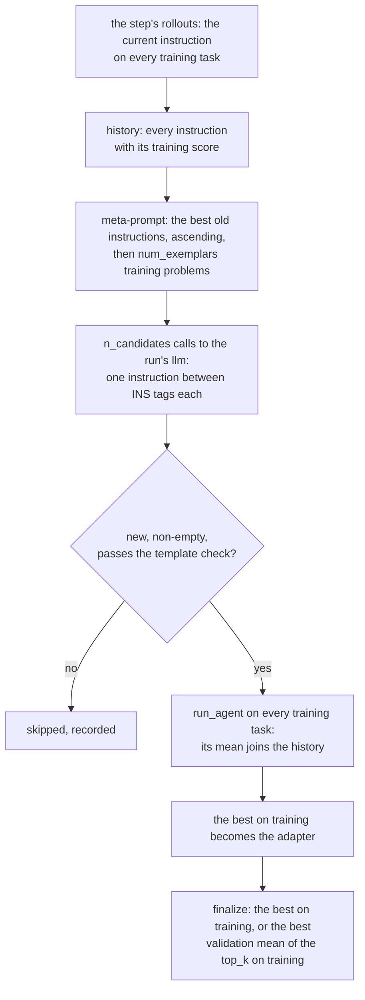

# OPRO

OPRO, Optimization by PROmpting ([Yang et al., ICLR 2024](https://arxiv.org/abs/2309.03409),
[code](https://github.com/google-deepmind/opro)), uses a model as the optimizer: it reads earlier instructions with
their training scores and a few training problems, and writes new instructions; every instruction it writes is
scored on the whole training set and joins the history. Choose it when the adapter is one instruction document,
the training split is small enough to run once per candidate, and you want the search to see the best
instructions so far with their scores.

## Setup

```yaml
template: prompt-only@1.0
evolver:
  name: opro
  params: {n_candidates: 4, select: validation, top_k: 3}
data:
  step_size: 50          # the training split's size: one OPRO step per framework step
  val: splits/val.txt    # for select: validation
trainer: {epochs: 3}     # OPRO steps
llm: {model: <backend>/<model>}   # the optimizer
```

The instruction is `ADAPTER.md`. The optimizer is the run's model (`llm`); on a model reachable only through a
ChatGPT login, OfficeQA's GPT-5.6-Luna setting makes each call one Codex session (`llm: {cli: codex}`). The judge's
scores must be in [0, 1]: the meta-prompt shows them from 0 to 100, and a step whose rollouts score outside that range
fails.

## One framework step

The Trainer's rollouts run the current instruction on every training task. Then (`run_evolution`, one `i_step`):

1. at the first step the rollouts are the initial instruction's score (step −1 in the history); later they re-score
   the current best and are recorded, not merged;
2. `num_exemplars` training problems are drawn at random for this step, from the runs that did not fail;
3. the meta-prompt: the best `max_num_instructions` instructions above `score_threshold`, in ascending order with
   scores 0–100, then the problems, then OPRO's request for a better instruction between `<INS>` and `</INS>`;
4. `n_candidates` optimizer calls on that one meta-prompt; each reply's instruction is extracted, polished and
   compared by md5 with every instruction generated before (as upstream, not with the initial one);
5. each new instruction passes the template check, runs on every training task (`run_agent`), and joins the history
   with its mean score. A wrong answer scores 0; a run that fails for an infrastructure reason (a container or
   proxy error) is run again, and an instruction whose runs fail twice is left unscored rather than scored 0;
6. the instruction with the best training score so far becomes the adapter.



`finalize` hands back the best on training (`select: train`, as the paper reports), or, with `select: validation`, the
best validation mean among the `top_k` best on training. Validation tasks never reach the meta-prompt.
`state/opro.json` holds the history, each candidate's per-task scores and one record per step; each step's
`output/` holds the meta-prompt, the replies and `report.md`.

## Parameters

```{literalinclude} ../../hermit/agent/evolver/methods/opro/evolver.yaml
:language: yaml
```

## The authors' implementation against this one

The authors' repository has no build configuration, so `meta_prompt.py` ports the meta-prompt, the reply parsing and
the de-duplication function by function (with a NOTICE), and `evolver.py` follows `run_evolution`. The meta-prompt
is the one of the authors' GPT optimizers with the instruction at the beginning of the question and no "Q:"/"A:",
the setting of their README's command; a test checks it against a stored output of their function.

| Dimension | google-deepmind/opro | This Evolver | Kind |
|---|---|---|---|
| When learning happens | Each step: 8 new instructions, each scored on the whole training subset | The same; one OPRO step per framework step, the step's rollouts on every training task (the first step refuses a smaller `step_size`). After the first step, those rollouts re-score the current best instruction: one more training pass per step, recorded, not merged into its score | Framework: the Trainer rolls out before each step |
| What the optimizer sees | Up to 20 instructions with scores, ascending; 3 random training problems with their gold answers, drawn with `np.random.seed(i_step)` from the whole training set | The same; the answer shown is the agent's answer when judged right, else the judge's feedback (OfficeQA's names the expected answer; a run with no answer shows its fail reason instead). The problems are drawn with `Random(seed × 100003 + i_step)` from the step's runs that did not fail | Task: the task has no gold field |
| What the acting agent sees | The instruction before the question in a one-shot prompt | `ADAPTER.md` as the agent's instructions, then the task | Framework |
| The instruction | One sentence, skipped past 500 characters; `polish_sentence` on each | One `ADAPTER.md` (OfficeQA's seed: 886 characters); `max_instruction_chars` off by default. `polish_sentence` is the authors' and runs on the whole document, so it removes Markdown's `**` bold markers | Decision: the row's starting skill |
| Score threshold | 0.0 for text-bison scorers, 0.3 for GPT scorers | `score_threshold: 0.0` | Decision: the scorer is an agent |
| Final selection | None in the code (it scores instructions on the eval split every 3 steps); the paper reports the best training instructions | `select: train`, or the best validation mean of the top `top_k` on training | Decision |
| Failures | Optimizer and scorer API errors retried until they succeed; an empty instruction is scored | A failed optimizer call tried once more, then dropped (a step can make fewer than `n_candidates`); a failed run tried once more, then the instruction is left unscored (the initial instruction's failed rollouts are run again); an empty instruction or one failing the template check is skipped and not generated again; at the hard budget, the instructions scored so far are kept, and `select: validation` falls back to the best on training. A candidate's runs that were run again are only in `tools.jsonl`; the initial instruction's are in the step's record. A run without `llm` or with an unknown `select` stops in `setup`, before its first rollouts | Framework |
| Models | GPT-3.5/GPT-4 (512 tokens) or PaLM 2 (1024) optimizer at temperature 1.0; text-bison or GPT scorer at temperature 0 | The run's `llm` as the optimizer (temperature 1.0 when the endpoint applies it; a Codex session does not); the task's acting agent as the scorer | Framework |
| Budget | 200 steps; GSM8K's 261 training questions | Config; OfficeQA: 3 steps of 4, 50 training questions | Decision: cost |
| Not ported | The PaLM meta-prompt, `instructions_only`, other exemplar criteria, the temperature schedule, few-shot evaluation of new instructions, the periodic eval-split scores, the GSM8K digit filter | — | Off by default or task-specific |

## What it is not

The scorer is an acting agent, not a one-shot model call: an instruction is scored by running the agent on every
training task, so one OPRO step costs `n_candidates × |train|` agent sessions (and the Trainer's pass of the current
best, `|train|` more) and a single noisy pass per instruction decides its place in the history. The exemplars' answers come from the step's rollouts and the judge's
feedback, since the task has no gold field. Selection on validation is a reproduction decision; OPRO itself has none.
