# AHE-Beta adapter evolution with Codex

This example connects AHE-Beta's native simulated users and demand pipeline to Hermit.
The learned object is a **Codex adapter**: instructions, skills, helper scripts, roles
and hooks. It does not evolve the Codex binary or the AHE controller. This is narrower
than AHE's original experiments, which evolved a complete NexAU Harness.

The first integration targets **Harbor 0.25.0, Codex 0.164.0 and local Docker**.
Interaction remains in this example; no user-simulation abstract has been added.

```mermaid
flowchart LR
    A[Frozen adapter and cohort] --> B[Harbor: one container per session]
    B --> C[Codex and native AHE user]
    C --> D[Stop writers and freeze outputs]
    D --> E[Native terminal review and Session]
    E --> F[Task verifier: experience reward]
    F --> G[Complete round of learning material]
    G --> H[Native triage / architect / divergent / owner]
    H --> I[Gitea and OpenAgents delivery]
    I --> J[Check adapter and record new version]
    J --> A
```



Direct tasks send one instruction and have a terminal reviewer, without a simulated
user steering the Actor. Interactive tasks use the native persona loop, including
live workspace inspection, messages and interruption. Terminal review reads frozen
files. A valid 1–4 experience rating becomes `(rating - 1) / 3`; this is **subjective
experience**, not independent benchmark correctness. A task's verifier publishes
this rating using Harbor's standard reward file.

## Install

Use Python 3.12+ and a working Docker daemon. Keep two source checkouts:

```bash
export HERMIT_ROOT=/path/to/hermit
export AHE_ROOT=/path/to/AHE-Beta
cd "$HERMIT_ROOT"
python3.13 -m venv .venv-ahe
. .venv-ahe/bin/activate
pip install -e '.[test]' -r examples/ahe_beta/requirements.txt
export PYTHONPATH="$AHE_ROOT/backend:$HERMIT_ROOT"
```

AHE currently uses a source checkout rather than an installable Python distribution.
Its feedback/delivery subprocess uses AHE's own locked environment:

```bash
cd "$AHE_ROOT"
uv sync --locked --extra experiments
```

Do not put Gitea, delivery or simulated-user credentials into the task image. The
Harbor process receives the native user configuration through `USER_LLM_BASE_URL`,
`USER_LLM_API_KEY` and `USER_LLM_MODEL`; Codex receives only its Actor credentials.
Set `ACTOR_API_KEY` separately. The Actor endpoint must support the Responses API;
a Chat Completions-only endpoint is insufficient. Use `--http-only` below when a
Responses gateway does not support WebSockets. No gateway address is hard-coded.

## Export a cohort

Run the exporter in AHE's environment. It verifies downloaded materials against the
existing task hashes and translates the container recipes into Harbor tasks:

```bash
cd "$AHE_ROOT"
PYTHONPATH=backend uv run --locked --extra experiments \
  python -m ahe_beta.integrations.hermit.export \
  --experiment examples/experiments/u8-mixed-e2b.json \
  --output /path/to/materials/u8-mixed --cache /path/to/material-cache
```

Replace the source file with `u8-direct-e2b.json`, `u16-mixed-e2b.json` or
`u32-mixed-e2b.json` for the other assignments. The exporter preserves each cohort's
persona reuse, task rotation, direct/simulated modes, source instructions, image
digests, companion services, declared artifacts and task budgets. Source `e2b`
configuration is recorded as provenance; the resulting tasks run in **local Harbor
Docker**, with separate resources for each session. Exporting is not a claim that
all 32 environments have been executed successfully.

The generated directory contains:

- `tasks/`: Harbor task packages, including container recipes and rating verifiers.
- `tasks.jsonl`: one immutable task/persona assignment per logical round and slot.
- `train.txt`: all sessions from R1–R5, in round order.
- `final-round.txt`: R6 only, using the final adapter without another delivery round.
- `cohort.json`: source configuration hash, group size, role counts and model metadata.

The final split is a **same-cohort observation**, not a held-out benchmark. Independent
benchmarks need a separate configuration and must not enter the feedback pipeline.
`--agent-seconds` is an explicit optional budget override; omitting it keeps each
task's declared budget (for example, KV's 28,800 seconds).

## Configure delivery and training

Provision a dedicated Gitea repository containing the files from
`hermit/adapter/templates/ahe_beta/`. Preserve hidden directories. Start the ordinary
OpenAgents worker for that repository using your existing Gitea configuration and
engineering gates. Keep a separate clean clone for this bridge: the OpenAgents
worker must not share that checkout. Repository creation and the OpenAgents worker's
lifecycle remain managed by their existing deployment tools.

Generate the Hermit configuration:

```bash
cd "$HERMIT_ROOT"
python examples/ahe_beta/prepare.py \
  --cohort /path/to/materials/u8-mixed \
  --ahe-root "$AHE_ROOT" --ahe-python "$AHE_ROOT/.venv/bin/python" \
  --harbor "$HERMIT_ROOT/.venv-ahe/bin/harbor" \
  --delivery-repo /path/to/clean-adapter-clone \
  --run-id u8-mixed-codex --actor-model YOUR_CODEX_MODEL \
  --actor-url https://your-responses-provider.example/v1 --http-only
```

Edit the generated `delivery.json` tracker URL, owner and repository. Its token is
referenced by environment-variable name (`GITEA_TOKEN`); never write it in JSON.
Configure AHE demand model variables and your OpenAgents worker's model separately.
The cohort metadata records the original experiment's models; these do not silently
become a Codex-compatible model configuration.

The generated `run.yaml` sets `step_size` to the **whole cohort**, `shuffle: false`
and one epoch, so one Hermit step equals one AHE round. User concurrency comes from
the source experiment. Its example run budget is 168 hours and the delivery call
limit is 24 hours; review these explicit limits before a full experiment.

```bash
python -m hermit check --no-probe --config /path/to/materials/u8-mixed/run.yaml
python -m hermit train --config /path/to/materials/u8-mixed/run.yaml
python -m hermit eval --config /path/to/materials/u8-mixed/run.yaml --adapter final
```

Use `check --no-probe` for configuration validation: the general Hermit probe runs
without an adapter and is not a complete AHE training round. Run the real smoke below
before the expensive experiment.

The Evolver reuses AHE's native feedback pipeline in the AHE Python environment.
Gitea commit identities and Hermit commit identities are kept separate and bound by
adapter content. A mismatching checkout, incomplete cohort or failed delivery stops
the round. Infrastructure failures raise `RunUnavailable`, leaving the Trainer step
unfinished. Completed rollouts and native delivery receipts are retained for resume;
restore the same files/configuration and rerun `train`. An already delivered round
can be reconciled without repeating valid user sessions or duplicating reports.

## Smoke checks

Build a small reusable image with Codex already installed, then verify insertion,
follow-up and interruption with a scripted model and user:

```bash
docker build -t ahe-hermit-smoke:local examples/ahe_beta/smoke
SMOKE_IMAGE=ahe-hermit-smoke:local DOCKER_GATEWAY=host.docker.internal \
  HARBOR_BIN="$HERMIT_ROOT/.venv-ahe/bin/harbor" \
  python examples/ahe_beta/smoke/smoke.py /path/to/new/channel-smoke
```

`DOCKER_GATEWAY` must be the host address reachable from Docker. On native Linux,
configure the Docker host-gateway mapping or provide the reachable host IP.
`DEBIAN_MIRROR` is an optional Docker build argument for dependency installation.

Run a real Codex model with the native user/reviewer:

```bash
python examples/ahe_beta/smoke/native.py \
  --output /path/to/new/native-smoke --ahe-root "$AHE_ROOT" \
  --harbor "$HERMIT_ROOT/.venv-ahe/bin/harbor" \
  --model YOUR_CODEX_MODEL --base-url https://your-provider.example/v1 \
  --http-only --interaction simulated_user
```

Repeat with a different output directory and `--interaction direct`. This creates a
small frozen test-adapter Git repository under the output directory. It does not
commit to either source checkout. Reports preserve Actor usage separately from user
usage, the complete native Session, frozen file bytes, conversation and tool events.

## Files and boundaries

| Component | Responsibility |
| --- | --- |
| AHE `integrations/hermit/session.py` | Native user lifecycle and full Session, deferred Issue plans |
| AHE `integrations/hermit/workspace.py` | Host workspace operations, freeze and native artifact collection |
| AHE `integrations/hermit/export.py` | Source task recipes and frozen cohort conversion |
| AHE `integrations/hermit/feedback.py` | Native report publication, demand roles and delivery recovery |
| `utils/hermit_user_codex.py`, `channel.py`, `user_hook.py` | One Codex process, mailbox interaction and Actor shutdown |
| `utils/acting.py`, `binding.py` | Per-task assignment, valid-rollout reuse and code-version binding |
| `hermit/agent/evolver/methods/ahe_beta/` | One full feedback/delivery cycle per training step |
| `hermit/adapter/templates/ahe_beta/` | Declared mutable adapter surface and fixed checker |

The initial hook/channel design comes from the Hermit authors' reference handoff for
Hermit `e813538`, Harbor 0.25.0 and Codex 0.164.0. This version adds native AHE lifecycle
integration, explicit shutdown, failure propagation and full evidence preservation.
It does not replace the authors' general interaction abstract or add another host.

Real smoke results cover a small file task in both modes and scripted control-message
races. The exported M02 and KV tasks also passed real Harbor environment startup;
KV finalization and both public and private measurement collection were exercised
without an Actor. This is environment acceptance, not a successful KV solution.
Full U8/U16/U32 training, OpenAgents delivery against a real model, and the remaining
task environments still need end-to-end acceptance before reporting experiments.
