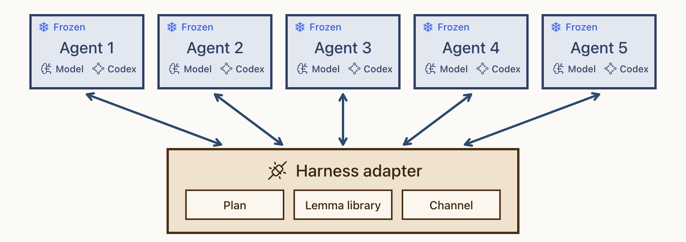
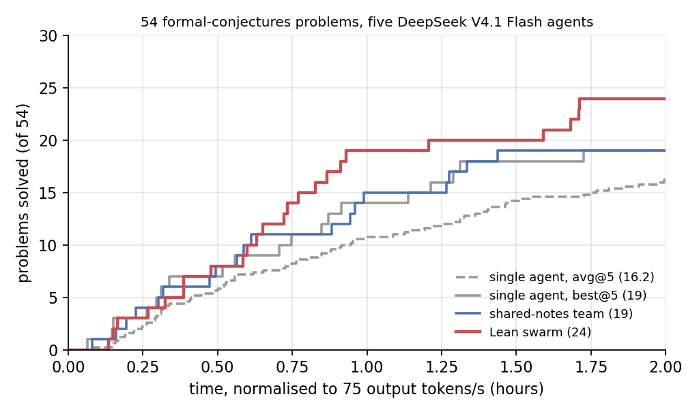

# Lean swarm

Five Codex agents prove one Lean theorem together. The adapter gives them a shared plan, a lemma library and a
channel through five tools (`check`, `pull`, `refute`, `say`, `plan`), plus the instructions and skills that tell
them how to split a proof and work on its parts; the first complete proof wins. The problems are open statements
from [formal-conjectures](https://github.com/google-deepmind/formal-conjectures) with a known proof, binned by the
size of that proof. This is a deploy example: it holds the finished adapter of the `lean-collab@1.0` template (the fixed team
service plus the learned instructions and skills), shows how five agents run on it, and compares it with single
agents and with a team that shares only free-text notes.

<p align="center">
  
</p>

Each agent talks only to the adapter: the plan, the proved lemmas and the messages all pass through it.

## Setup

Install the framework first ([Installation](../../docs/get-started/installation.md)). Check the adapter against its template:

```bash
python -m harnessadapter.spec examples/lean_swarm/adapter --root harnessadapter/algorithms/templates/lean_collab
```

Also needed: the Codex CLI, bubblewrap and socat on PATH, the key of the model's backend (`FIREWORKS_API_KEY` for
the default; `--model <backend>/<model id>` binds another that serves the Responses API, see
[Model backends](../../docs/guides/model-backends.md)), and a Lean
toolchain with a [formal-conjectures](https://github.com/google-deepmind/formal-conjectures) checkout whose Mathlib is
built (`COLLAB_REPO`, default `~/code/formal-conjectures`; `COLLAB_LAKE`, default `~/.elan/bin/lake`; nothing here
installs them).

## Run

One command runs one problem with five agents:

```bash
export FIREWORKS_API_KEY=...
examples/lean_swarm/launch.sh ErdosProblems/494.lean erdos_494.variants.k_eq_card      # a file under FormalConjectures/, the target theorem
examples/lean_swarm/launch.sh my/Problem.lean my_theorem --agents 3 --cap 3600 --model fireworks/accounts/fireworks/models/glm-5p3-flash
```

The run goes to `$LEAN_SWARM_RUNS/<problem>__<theorem>/` (default `~/code/lean-swarm-runs`): `launch.log`, one
workspace per agent with its `Problem.lean` and `events.jsonl`, the team's `library/`, and `result.json` at the
end (who solved it, when, tokens and cost per agent). `--dry-run` prepares everything and starts the service
without starting an agent. The launcher does, in order:

1. **Service.** Starts the team service with a config naming the adapter, one endpoint per agent and the
   `COLLAB_*` variables: the shared library directory, the target theorem and the Lean checkout.
2. **Workspaces.** `harnessadapter deploy` of the adapter into one workspace per agent (its instructions into
   `AGENTS.md`, its skills under `.codex/skills/`), plus the problem as `Problem.lean` with the target left as
   `sorry`.
3. **Agents.** `codex exec` in each workspace with the task and the agent's own endpoint as the `team` MCP server,
   so the five tools reach the service as that agent. Each agent runs in a bubblewrap jail with no network: its
   workspace is writable, the Lean checkout is read-only with the problem sources hidden, and only two sockets are
   bridged in, the model relay and the agent's team endpoint.
4. **Reactions and the judge.** Every 5 s the launcher posts the agents' status to the service and carries out
   what the adapter decided (interrupt a running agent, resume an ended one, each with a text), and grades every
   changed `Problem.lean` in a Lean jail. The first proof that compiles without `sorry` or extra axioms ends the run,
   so does the time cap.

To run the pieces by hand instead, [docs/recipes/lean-collaboration.md](../../docs/recipes/lean-collaboration.md)
has the service config and the per-agent `deploy` command.

## Results

54 formal-conjectures problems whose known proofs are 800 to 3,000 lines long, five DeepSeek V4.1 Flash agents
(reasoning effort high) per problem in every method, one proof attempt per problem with a two-hour budget; a problem counts as
solved when a proof compiles without `sorry` or extra axioms.



Problems solved against time, normalised to an API speed of 75 output tokens/s. avg@5 and best@5 are five
independent single agents; the shared-notes team shares one notes file.

## Code

```text
adapter/
  adapter.yaml        template, exports (context, five team tools, reactions, skills), structure, origin
  ADAPTER.md          context every agent reads (learnable)
  skills/             good-map, good-leaf, kernel-check, lean-workflow, solving-together (learnable)
  collab.py           the five tools: check, pull, refute, say, plan (fixed)
  assembly.py         assembling the proof from the verified parts (fixed)
  reactions.py        the service's interrupt and resume decisions (fixed)
  CARD.md             how the adapter was obtained and evaluated; EVOLVER.md, README.md
launch.sh, launch.py  the all-in-one run: service, workspaces, jailed agents, reactions, judge
```

The tools read `COLLAB_DIR`, `COLLAB_AGENT`, `COLLAB_WORKSPACE`, `COLLAB_TARGET`, `COLLAB_REPO` and `COLLAB_LAKE`
from the environment the service sets per agent (see `adapter/README.md`).
