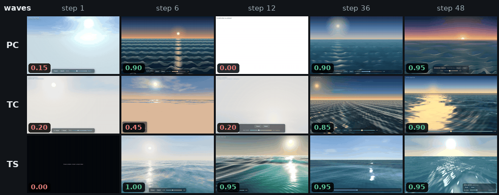
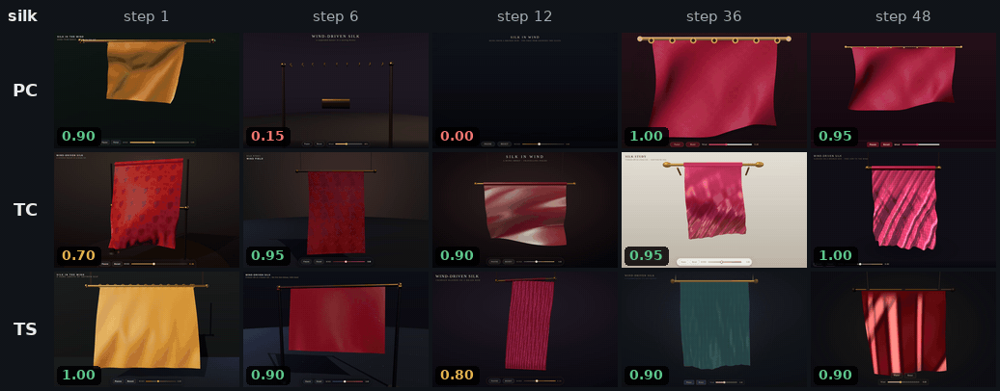
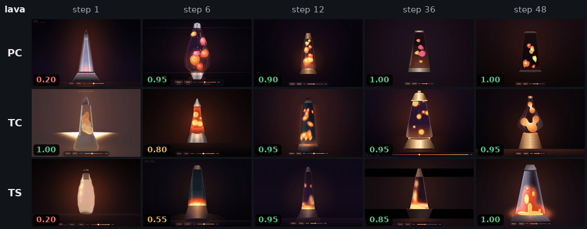

# Visual showcase

An acting agent, GLM 5.3 Flash, writes one offline, interactive, animated WebGL page, `index.html`, for a short
brief: ocean waves (`waves`), wind-driven silk (`silk`) or a lava lamp (`lava`). It has four generic tools,
`write_file`, `read_file`, `replace_text` and `run_command` (one `bash -c` command in a bubblewrap sandbox; PNG files a
command writes are shown to the model), and is told nothing about browsers: to see its page it has to render the
page itself. A headless browser then runs the submitted page and takes five screenshots, and GLM 5.3 Flash rates
five visual dimensions from them without being told the method or the step (score 0 to 1).

Experiment 4 trains one harness adapter per brief with each of three methods, 48 steps each, with GLM 5.3 as the
learner:

| Row | Method | What the learner writes | Configs |
|---|---|---|---|
| **PC** | [Prompt-only](../../docs/methods/prompt-only.md): the prompt-only template with the built-in Codex Evolver, as the CL-Bench poker example runs it | `ADAPTER.md`, the agent's instructions | [`prompt_only_codex/`](prompt_only_codex/) |
| **TC** | [Toolsmith](../../docs/methods/toolsmith.md) with the same Codex Evolver, plus one task tool, `test_tools`, that self-tests its tools on the agent's machine | `ADAPTER.md` and tool bundles (`tools/<name>/`) that the agent's harness exposes as function tools whose results carry images | [`toolsmith_codex/`](toolsmith_codex/) |
| **TS** | Toolsmith with its own scripted Evolver, which self-tests every changed tool in the agent's sandbox | the same as TC | [`toolsmith/`](toolsmith/) |

## Watch them learn

One grid per brief. Rows are the methods; columns are training steps 1, 6, 12, 36 and 48. Each cell is the page that
step's training run submitted, the version the judge scored: step 1 is before any learning, and step N uses the
adapter after N − 1 updates. The corner shows the judge's score. A white cell is the host's placeholder page (the
agent submitted nothing); a black or empty one is a page that failed to render, as the judge also saw it. The pages
were rendered again as the judge's capture renders them (Chromium, GPU WebGL, 1280 × 800), each on a paused virtual
clock advanced 100 ms per frame: three seconds of page time after a one-second warm-up, so all cells play in step.

### waves



### silk



### lava



## Results

Mean judge score of each checkpoint's adapter on its brief: 5 runs at steps 12, 24 and 36, 10 at step 48.

| Brief | Method | Step 12 | Step 24 | Step 36 | Step 48 |
|---|---|---|---|---|---|
| waves | PC | 0.95 | 0.92 | 0.73 | 0.85 |
| waves | TC | 0.86 | 0.61 | 0.51 | 0.86 |
| waves | TS | 0.77 | 0.87 | 0.87 | **0.955** |
| silk | PC | 0.91 | 0.95 | 0.95 | **1.00** |
| silk | TC | 0.88 | 0.86 | 0.89 | 0.85 |
| silk | TS | 0.85 | 0.71 | 0.87 | 0.865 |
| lava | PC | 0.72 | 0.81 | 0.96 | **0.95** |
| lava | TC | 0.68 | 0.97 | 0.90 | 0.835 |
| lava | TS | 0.61 | 0.81 | 0.75 | 0.755 |
| mean of the three | PC | 0.86 | 0.89 | 0.88 | **0.93** |
| mean of the three | TC | 0.81 | 0.81 | 0.77 | 0.85 |
| mean of the three | TS | 0.74 | 0.80 | 0.83 | 0.86 |

- **One training run per method and brief.** The table describes these runs; it does not rank the methods. A single
  failed eval run moves a five-run mean by up to 0.2, which is why the curves are not monotone: 14 of the 225 eval
  runs scored 0.2 or less, most of them because no page was submitted or a shader or script error left the page
  blank. PC lava step 12 includes one run whose capture timed out (no verdict, counted as 0; 0.90 without it).
- **Averaged over the three briefs, every method scored higher at step 48 than at step 12** (PC +0.07, TC +0.04, TS
  +0.12); PC on waves and TC on silk ended lower. Prompt-only ends highest on silk and lava, toolsmith with its
  scripted learner on waves.
- **The agents looked at their pages.** At step 48 every TC and TS eval run called its learned tool to see its page.
  PC's agents rendered their page through `run_command` and looked at it in all ten runs on waves and lava; on silk
  they never looked and still scored 1.00 in all ten runs.
- **What the toolsmith learners built** (step 48): TC grew one render-and-look tool per brief (`look_page`,
  `inspect_silk`); TS grew two each, a scene checker and a helper (`vendor_check`, a static audit of the page against
  the brief's contract; `glsl_check`, shader compilation; `page_edit`, several text replacements in one call).
  `utils/tool_works.py`, an offline check that a learned tool
  renders a known page truthfully, passes every checkpoint of TC and TS on waves and silk and of TS on lava; TC's lava
  tool passes steps 1 to 6 only, after which it times its frames differently from the reference capture (best
  correlation 0.79 against a threshold of 0.8).
- The judge is the acting model itself, so the scores are that model's view, not a human rating.

A 48-step training run took 3.6 to 6.8 hours with PC, 9.7 to 12.2 with TC and 10.8 to 13.8 with TS, plus 1 to 3.6
hours for its 25 eval runs, with three training runs at a time on one machine that other users shared (the host's
captures take turns under a lock). Model spend for experiment 4 was about 214 USD; the nine runs in the table took
about 202 USD of it, the rest an interrupted first attempt, runs stopped when the arms changed, and a cancelled second
seed.

## Run it

Install the framework ([Installation](../../docs/get-started/installation.md)), Node 20 or newer, the capturer's
packages and Playwright's Chromium, and bubblewrap with unprivileged user namespaces; the
[recipe](../../docs/recipes/visual-showcase.md) lists the requirements. Then, from the repository root:

```bash
npm ci --prefix examples/visual_showcase/utils/runtime
(cd examples/visual_showcase/utils/runtime && npx playwright install chromium)
export VISUAL_CHROME_BIN=$(ls -d ~/.cache/ms-playwright/chromium-*/chrome-linux64/chrome | tail -1)   # that Chromium
export VISUAL_CHROME=$PWD/examples/visual_showcase/utils/runtime/chrome-gpu.sh   # the host's captures, with GPU WebGL
python examples/visual_showcase/utils/prepare.py                       # tasks, splits, the learners' task-info
python examples/visual_showcase/utils/confine.py selftest ~/.cache/visual_showcase/selftest   # the sandbox pre-flight
export FIREWORKS_API_KEY=...                                           # the agent, the judge and the learners
```

Toolsmith with its scripted learner (TS), per brief:

```bash
hermit check --no-probe --config examples/visual_showcase/toolsmith/run4_waves.yaml
hermit train --config examples/visual_showcase/toolsmith/run4_waves.yaml
hermit eval  --config examples/visual_showcase/toolsmith/run4_waves.yaml --adapter waves-ts/ckpt-step-48 eval.repeats=10
```

PC and TC run the Codex CLI as the learner. It reaches the model through the metering relay
`hermit/runtime/wire_meter.py`, which adds the key itself, so the learner's session holds only a placeholder:

```bash
export RELAY_PLACEHOLDER_KEY=placeholder     # the session's key: any dummy value; the relay sends FIREWORKS_API_KEY
PORT=3460 UPSTREAM=https://api.fireworks.ai UPSTREAM_KEY_ENV=FIREWORKS_API_KEY LEDGER=waves-pc-ledger.json \
  REWRITE_DEVELOPER_ROLE=1 REWRITE_STRIP_SERVER_TOOLS=1 REWRITE_REPAIR_TOOL_ARGS=1 \
  python -m hermit.runtime.wire_meter &
hermit train --config examples/visual_showcase/prompt_only_codex/run4_waves.yaml \
  backends.learner.base_url=http://127.0.0.1:3460/waves-pc/inference/v1
hermit eval  --config examples/visual_showcase/prompt_only_codex/run4_waves.yaml --adapter waves-pc/ckpt-step-48 \
  backends.learner.base_url=http://127.0.0.1:3460/waves-pc/inference/v1 eval.repeats=10
```

`toolsmith_codex/run4_<brief>.yaml` runs the same way. Every step is tagged `<run>/ckpt-step-N` (`waves-pc`,
`waves-tc`, `waves-ts`, …); evaluation runs 5 repeats unless `eval.repeats` says otherwise (10 for step 48 above).
[`utils/README.md`](utils/README.md) describes the agent, the limits of a run and every record a run writes;
`utils/tool_works.py` reruns the tool check on a checkpoint.

## Code

```text
utils/agent/        the acting agent: agent.py (VisualAgent), generic_harness.py (its tools, image packing), texts.py
utils/pipeline.py   the agent's model and settings, the adapter as the agent sees it, the host's final capture
utils/harness.py    the browser capture: runtime/browser_capture.cjs, one capture at a time
utils/confine.py    the bubblewrap sandbox of run_command, the learned tools and the self-tests; its selftest
utils/judge.py      12 mechanical items and the GLM vision rubric      utils/prepare.py   tasks, splits, task-info
utils/runtime/      browser_capture.cjs (Playwright) and its packages; chrome-gpu.sh, Chromium with GPU WebGL
utils/tool_selftest.py   test_tools, the toolsmith self-test as a task tool (TC)
utils/tool_works.py offline check: does a learned tool render a known page truthfully
utils/reference/    webgl_probe.html and three reference pages, for the checks
utils/tests/        tests of the sandbox, the agent and the self-test tool
prompt_only_codex/  PC: run4_<brief>.yaml      toolsmith_codex/   TC: run4_<brief>.yaml
toolsmith/          TS: run4_<brief>.yaml
assets/             the animations above
```
